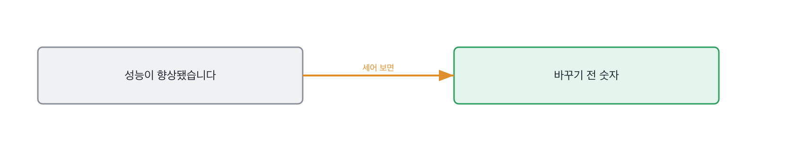

# 13.1 좋아졌다는 말의 근거

*[12.4](../12-g12/q042.md) 까지가 만든 것을 봤죠. 이번엔 만든 것이 좋아졌는지를 무엇으로 알았는지 봅니다.*

> **이 말부터**
>
> **기준선** 바꾸기 전에 재 둔 숫자를 말합니다. 이게 없으면 뒤에 잰 숫자도 뜻이 없어요.
>
> **정답 목록** 질문과 그때 나와야 하는 문서를 손으로 적어 둔 목록을 말합니다.

이 장부터 렌즈가 평가로 바뀝니다. 좋아졌다는 것을 무엇으로 쟀는지를 봐요.
그런데 이 자리가 4단계의 어느 칸보다 잘 안 걸립니다. 좋아졌다는 말은 아무도 안 캐묻거든요.
좋아졌다는데 그걸 왜 따지겠어요. 그래서 이 자리에 빈 답이 가장 오래 살아남습니다.

좋아졌다는 문장이 성립하려면 숫자가 둘 있어야 합니다. 바꾸기 전 하나와 바꾼 뒤 하나요.
하나만 있으면 그건 좋아졌다는 말이 아니라 그냥 잰 겁니다.
**둘 중에 늘 없는 쪽은 앞의 것입니다.** 바꾸고 나서 재는 사람은 많고 바꾸기 전에 재 두는 사람은 드물어요.

그리고 그 앞 숫자를 만들려면 그전에 할 일이 하나 더 있습니다. 정답 목록을 만드는 일이요.
질문 다섯 개를 뽑고 그때 나와야 하는 문서를 손으로 붙이는 일인데, 이게 지루합니다.
지루한 데다 티도 안 나서 대개 건너뜁니다. 건너뛰면 그날부터 좋아졌다는 말만 남아요.

이 책의 검색 서비스에도 그 목록을 붙였습니다. 질문 다섯 개짜리입니다.

```python
@dataclass(frozen=True)
class Case:
    query: str
    gold: tuple[str, ...]

CASES: tuple[Case, ...] = (
    Case("환불 며칠", ("refund", "refund-2025")),
    Case("배송 얼마나", ("ship",)),
    Case("쿠폰 환불", ("coupon",)),
    Case("비밀번호 언제", ("signup",)),
    Case("환불 개정", ("refund-2025",)),
)

# 만든 사람: 저자. 만든 날짜: 2026-08-27.
# 다섯 개는 실제로 들어온 질문에서 골랐고 정답 문서는 손으로 붙였다.
```

다섯 개면 적죠. 적은 걸 아는 채로 쓰는 것과 모르고 쓰는 것이 다릅니다.
그래서 파일 맨 아래에 누가 언제 만들었는지를 적어 뒀어요. [9.1](../09-g09/q030.md) 에서 라벨을 누가 붙였냐고
물었던 그 자리가 여기서 우리 쪽으로 돌아옵니다. 우리 정답 목록도 누군가 손으로 붙인 겁니다.

> **이렇게 답합니다**
>
> 여러 지표를 종합적으로 확인하여 성능이 향상된 것을 검증했습니다.
> 정량적 평가와 정성적 평가를 병행했습니다.
> 사용자 피드백도 긍정적이었습니다.
> 전반적으로 만족스러운 수준의 개선을 이뤘습니다.

네 줄에 숫자가 하나도 없습니다. 그리고 견준 대상이 끝까지 안 나와요.

> **표시해 보면**
>
> 여러 지표를 종합적으로 확인하여 성능이 향상된 것을 검증했습니다.
>     ← 어느 지표인지 없음. 바꾸기 전 값이 없음
> 정량적 평가와 정성적 평가를 병행했습니다.
>     ← 평가 이름만 있음. 무엇을 몇 개 쟀는지 없음
> 사용자 피드백도 긍정적이었습니다.
>     ← 몇 명이 무엇을 말했는지 없음
> 전반적으로 만족스러운 수준의 개선을 이뤘습니다.
>     ← 견준 대상이 끝까지 안 나옴

첫 줄의 여러 지표가 이 답의 전부입니다. 어느 지표인지도 없고 바꾸기 전 값도 없어요.
둘째 줄은 평가 방식의 이름만 댑니다. 정량과 정성이라는 낱말은 무엇을 몇 개 쟀는지를 안 말해요.
**셋째 줄의 사용자 피드백에는 사람이 없습니다.** 몇 명이 무엇을 말했는지가 빠져 있거든요.



> **이렇게 파고듭니다**
>
> 물음: 바꾸기 전 숫자가 몇이었어요?
>
> 답: 정확한 수치는 기억나지 않지만 유의미한 개선이 있었습니다.

기억나지 않는다는 답이 나오면 거기서 정해집니다. 잰 사람은 그 숫자를 안 잊어요.
자기가 며칠 붙잡고 만든 숫자거든요. 잊는 건 남이 준 숫자를 받아 적은 사람입니다.

> **재 본 사람이면**
>
> 질문 다섯 개짜리 목록을 먼저 만들었어요. 정답 문서는 제가 손으로 붙였고요.
> 기준선이 재현율 0.83이었습니다. 다섯 중 하나를 아예 못 찾았어요.
> 청크를 40에서 30으로 줄이니까 1.0이 됐습니다. 그거 하나만 바꿨습니다.
> 목록이 다섯이라 이 숫자는 못 믿어요. 방향만 봤습니다.

첫 줄이 목록 이야기입니다. 다섯 개를 만들고 정답을 손으로 붙였다고 하죠.
둘째 줄에 기준선이 나와요. 0.83이고, 다섯 중 하나를 아예 못 찾았다는 것까지 붙습니다.
**못 찾은 하나를 세어 본 사람만 아는 숫자예요.** 평균만 본 사람은 이 문장을 못 씁니다.

셋째 줄이 이 답의 중심입니다. 청크를 40에서 30으로 줄여서 1.0이 됐고, 그거 하나만 바꿨다고 합니다.
하나만 바꿨다는 말이 여기서 값이 나갑니다. 둘을 같이 바꾸면 어느 쪽이 움직였는지 못 보거든요.
[11.2](../11-g11/q037.md) 에서 단계를 하나씩 잘랐던 손이 여기서는 손잡이를 하나씩 돌리는 손이 됩니다.

넷째 줄이 제가 제일 좋아하는 자리예요. 목록이 다섯이라 이 숫자는 못 믿겠다고 말하거든요.
자기가 만든 숫자의 크기를 자기가 깎는 문장입니다. 이건 재 본 사람만 씁니다.
안 재 본 사람은 숫자가 없으니 깎을 것도 없거든요.

> **현장에서는**
>
> 저는 기준선을 물을 때 값을 대라고 안 하고 어디에 적어 뒀냐고 묻습니다.
> 적어 둔 자리를 대는 사람과 기억을 더듬는 사람은 거기서 갈립니다.

기준선 이야기가 여기까지입니다. 앞 숫자 하나와 그 숫자를 만든 방법 하나요.
둘이 나오면 이 칸은 통과입니다.

> **판정**
>
> 바꾸기 전 숫자와 바꾼 뒤 숫자를 둘 다 대고, 그사이에 무엇을 하나 바꿨는지 말하면 통과입니다.
> 표본이 작아서 못 믿는다고 스스로 깎으면 아주 좋은 신호예요.
>
> 종합적으로 개선됐다고만 하고, 바꾸기 전 숫자를 물어도 기억나지 않는다거나
> 유의미한 개선이었다고 답하면 다음 라운드로 안 보냅니다.
>
> 기록에는 이렇게 적습니다. 질문 다섯 개짜리 정답 목록을 손으로 만들었고, 기준선 0.83에서
> 청크 하나만 바꿔 1.0이 된 것을 댔으며, 표본이 다섯이라 방향만 봤다고 스스로 밝혔다.

> **물을 문장 둘**
>
> 좋아졌다고 하면 다들 고개를 끄덕입니다. 그래서 앞 숫자를 묻습니다.
> 앞 숫자를 대면 그 숫자를 어떻게 만들었는지가 따라 나오고, 그 만드는 과정이 증거입니다.
>
> **그대로 읽으세요.** *바꾸기 전 숫자가 몇이었어요?*
>
> **답을 받으면 이어서.** *그 숫자는 뭘로 잰 거죠? 정답 목록은 누가 만들었어요?*

> **이걸 놓치면**
>
> 앞 숫자를 못 받으면 [13.2](q044.md) 에서 같이 내려간 것을 물어도 견줄 자리가 없습니다.

