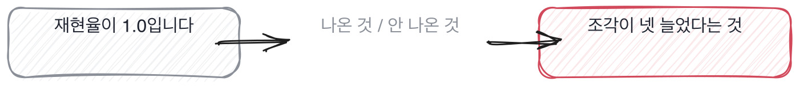

# 13.2 지표가 가리는 것

*[13.1](q043.md) 에서 앞 숫자를 받았죠. 이번엔 그 숫자가 오를 때 내려간 쪽을 봅니다.*

> **이 말부터**
>
> **재현율** 나와야 하는 문서 중에 실제로 몇을 데려왔는지를 말합니다.
>
> **정밀도** 데려온 것 중에 몇이 정답이었는지를 말해요. 이 둘은 같이 안 움직입니다.

숫자 하나만 보면 늘 좋아 보입니다. 손잡이를 돌려서 그 숫자가 올라가면 성공이니까요.
문제는 손잡이 하나가 숫자 하나만 건드리지 않는다는 데 있습니다.
**하나를 올리면 대개 다른 하나가 내려갑니다.** 그 내려간 쪽을 안 재면 안 보이고요.

이 자리에서 해 본 사람과 안 해 본 사람이 갈립니다. 해 본 사람은 내려간 쪽을 반드시 봤어요.
안 봤으면 언젠가 한 번 크게 데였을 거고, 데이고 나면 그다음부터는 봅니다.
안 해 본 사람은 올라간 숫자만 들고 옵니다. 그게 자랑거리니까요.

검색 서비스로 그 자리를 만들어 보겠습니다. 손잡이를 두 번 돌립니다. 한 번에 하나씩요.

돌려 보면 이렇게 나옵니다. 손잡이를 한 번에 하나씩 돌려 세 번 쟀습니다

```
기준선                  재현율 0.833  정밀도 0.667  건진 정답 5/6  뽑아 온 조각 9
청크만 30으로             재현율 1.000  정밀도 0.727  건진 정답 6/6  뽑아 온 조각 11
거기서 top_k 만 5로       재현율 1.000  정밀도 0.667  건진 정답 6/6  뽑아 온 조각 15
규칙 심판과 사람이 맞은 비율 0.5
어긋남 사람은 틀리다 규칙은 맞다 환불 정책은 여러 요소를 종합적으로 고려
어긋남 사람은 틀리다 규칙은 맞다 쿠폰은 상황에 따라 다르게 적용될 수 있
어긋남 사람은 맞다 규칙은 틀리다 사흘 안에 정하시면 됩니다.
어긋남 사람은 틀리다 규칙은 맞다 해당 문의는 고객센터를 통해 안내받으실
```

첫 줄이 기준선입니다. 재현율 0.833에 정밀도 0.667이고 조각을 아홉 개 뽑았어요.
둘째 줄에서 청크만 30으로 줄였더니 재현율이 1.0이 됐습니다. 못 찾던 하나를 찾은 거죠.
정밀도도 같이 올랐고요. 여기까지는 좋은 이야기입니다.

셋째 줄이 이 칸의 자리입니다. top\_k 만 5로 올렸어요. 그런데 재현율이 안 움직입니다.
1.0에서 1.0입니다. 정밀도만 0.727에서 0.667로 내려갔고 조각은 11개에서 15개가 됐어요.
**못 찾던 걸 더 찾은 게 아니라 이미 찾던 데다 네 개를 얹은 겁니다.**



네 개가 늘어난 만큼 맥락이 길어지고, 길어진 만큼 값이 나가고, 답은 그대로입니다.
그런데 대시보드에는 재현율 1.0만 찍혀요. 조각 수는 아무도 안 보고 있고요.
지표가 가린다는 말이 이겁니다. [11.1](../11-g11/q036.md) 에서 뺀 것을 물었던 자리가 여기서 숫자로 돌아옵니다.

> **이렇게 답합니다**
>
> 주요 지표가 개선되었고 다른 지표들도 안정적으로 유지되었습니다.
> 트레이드오프 없이 전반적인 품질 향상을 달성했습니다.
> 모니터링 결과 이상 징후는 발견되지 않았습니다.

둘째 줄이 이 답을 정합니다. 내준 것 없이 좋아졌다는 말이거든요.

> **표시해 보면**
>
> 주요 지표가 개선되었고 다른 지표들도 안정적으로 유지되었습니다.
>     ← 다른 지표가 무엇인지 없음. 안 재 봤을 수 있음
> 트레이드오프 없이 전반적인 품질 향상을 달성했습니다.
>     ← 내준 것이 없다는 말. 그런 개선은 드물다
> 모니터링 결과 이상 징후는 발견되지 않았습니다.
>     ← 무엇을 보고 있었는지 없음

첫 줄의 다른 지표들은 이름이 없습니다. 이름이 없으면 안 재 봤을 가능성이 큽니다.
둘째 줄이 트레이드오프 없이로 닫는데, 저는 이런 개선을 거의 못 봤습니다.
**셋째 줄은 이상이 없었다고 말하면서 무엇을 보고 있었는지를 안 댑니다.**

> **이렇게 파고듭니다**
>
> 물음: 맥락에 들어가는 조각 수는 어떻게 됐어요?
>
> 답: 그 부분은 별도로 측정하지 않았습니다.

별도로 측정하지 않았다는 답은 정직한 답입니다. 그리고 그 자리에서 판정이 섭니다.
안 잰 것을 안 쟀다고 말하는 건 좋은데, 안 잰 사람은 내려간 쪽을 볼 수가 없거든요.

> **재 본 사람이면**
>
> top_k 를 3에서 5로 올렸는데 재현율이 안 움직였어요. 그대로 1.0이었습니다.
> 정밀도만 0.73에서 0.67로 내려갔고요. 뽑아 온 조각은 11개에서 15개가 됐습니다.
> 못 찾던 걸 더 찾은 게 아니라 이미 찾던 데다 네 개를 더 얹은 겁니다.
> 그래서 되돌렸어요. 맥락만 길어지고 답은 그대로였거든요.

첫 줄에 안 움직인 숫자가 나옵니다. 올린 이야기가 아니라 안 올라간 이야기예요.
둘째 줄에 내려간 쪽과 늘어난 쪽이 같이 나옵니다. 0.73에서 0.67로, 11개에서 15개로요.
**안 움직인 숫자를 말하는 사람은 두 번 이상 잰 사람입니다.**

셋째 줄이 그 둘을 한 문장으로 잇습니다. 더 찾은 게 아니라 얹은 거라고요.
그리고 넷째 줄에서 되돌립니다. [8.2](../08-g08/q028.md) 에서 되돌린 양을 물었던 그 자리가
평가에서 다시 나와요. 올린 것을 되돌리는 건 재 본 사람만 할 수 있는 일입니다.

> **여기서 다들 속는다**
>
> 지표가 올랐다는 말은 확인된 것처럼 들립니다. 숫자가 붙어 있으니까요.
> 그런데 숫자 하나는 방향을 안 알려 줍니다. 무엇을 내주고 얻은 숫자인지가 빠져 있거든요.
> 그래서 저는 오른 숫자를 들으면 반드시 짝을 묻습니다. 같이 움직인 게 뭐였냐고요.
> 짝이 없다는 답이 나오면 그건 한 번만 쟀다는 뜻입니다.

가린 쪽 이야기는 여기까지입니다. 오른 숫자 옆에 안 오른 숫자가 있느냐만 보면 돼요.
되돌린 이야기까지 나오면 더 파고들 자리가 없습니다.

> **판정**
>
> 오른 숫자 옆에 내려간 숫자나 안 움직인 숫자를 같이 대면 통과입니다.
> 그래서 되돌렸다는 말까지 나오면 아주 좋은 신호예요.
>
> 트레이드오프 없이 좋아졌다고 하고, 같이 움직인 숫자를 물어도 안 쟀다거나
> 다른 지표도 안정적이었다고만 답하면 다음 라운드로 안 보냅니다.
>
> 기록에는 이렇게 적습니다. top\_k 를 올렸는데 재현율이 1.0에서 안 움직였고 정밀도만
> 0.73에서 0.67로 내려간 것을 댔으며, 맥락만 길어져서 되돌렸다고 말했다.

> **물을 문장 둘**
>
> 좋아진 숫자는 다들 준비해 옵니다. 안 좋아진 숫자는 아무도 안 준비해요.
> 그래서 짝을 묻습니다. 짝을 대면 두 번 이상 쟀다는 뜻이고, 두 번 잰 사람은 손잡이를 아는 사람입니다.
>
> **그대로 읽으세요.** *그 숫자가 오를 때 같이 내려간 건 뭐였어요?*
>
> **답을 받으면 이어서.** *안 움직인 숫자도 있었나요? 그래서 되돌린 건 있어요?*

> **이걸 놓치면**
>
> 가린 쪽을 못 물으면 [15.2](../15-g15/q050.md) 에서 조용히 나빠지는 것을 물어도 오른 숫자만 옵니다.

