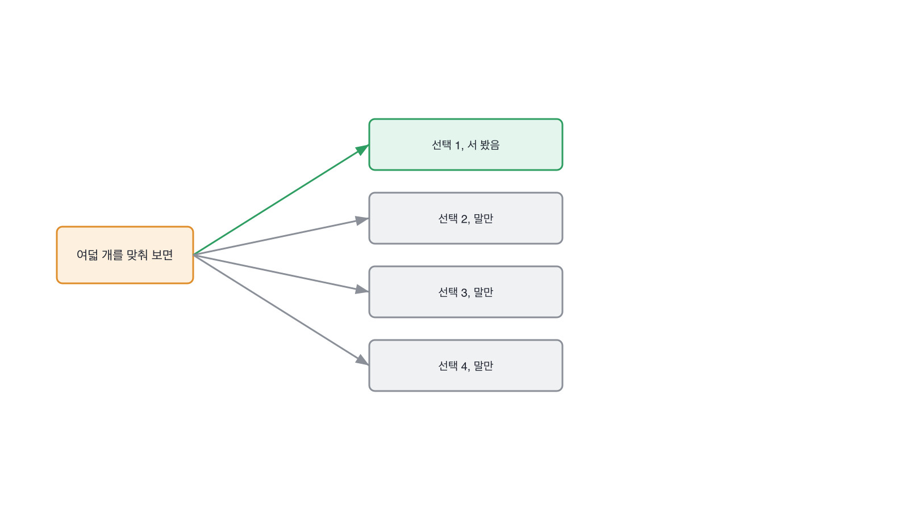

# 13.3 사람이 채점한 것, 모델이 채점한 것

*[13.2](q044.md) 에서 가린 쪽을 봤죠. 이번엔 그 숫자를 매긴 쪽이 누구였는지를 봅니다.*

> **이 말부터**
>
> **심판** 답변에 점수를 매기는 쪽을 말합니다. 사람일 수도 있고 모델일 수도 있어요.
>
> **어긋남** 두 심판이 같은 답에 다른 점수를 준 건수를 말합니다. 평균이 아니라 건수입니다.

답변 품질을 재려면 누군가 점수를 매겨야 합니다. 사람이 매기면 느리고 비싸요.
그래서 모델한테 시킵니다. 이건 합리적인 선택이고 저도 그렇게 합니다.
문제는 그다음입니다. **그 심판이 맞게 매기는지는 누가 확인하죠?**

확인하는 방법은 하나뿐입니다. 같은 답 뭉치를 사람도 매기고 심판도 매겨서 어긋난 건수를 세는 거요.
어렵지 않습니다. 여덟 개면 됩니다. 그런데 이걸 하는 사람이 드물어요.
심판을 붙이는 건 하루면 되고 맞춰 보는 건 반나절이 더 드는데, 그 반나절이 잘 안 나옵니다.

검색 서비스에 붙여 본 심판이 이렇게 생겼습니다. 규칙 둘로 매깁니다.

```python
def rule_score(text: str) -> int:
    """길고 숫자가 들어 있으면 잘 쓴 답으로 본다. 흔히 쓰는 어림 규칙이다."""
    long_enough = len(text) >= 20
    has_number = bool(DIGIT.search(text))
    return 1 if (long_enough or has_number) else 0
```

길거나 숫자가 들어 있으면 잘 쓴 답으로 봅니다. 어림잡은 규칙이고, 그럴듯하죠.
답변 여덟 개에 이 규칙을 돌리고 제가 매긴 것과 맞춰 봤더니 넷이 어긋났습니다.
절반이에요. 그리고 어긋난 넷 중 셋이 같은 모양이었습니다.



길고 숫자가 있는데 답이 아닌 것 셋. 종합적으로 고려하여, 상황에 따라 다르게,
고객센터를 통해 안내받으실 수. **규칙이 길이를 보고 있었던 겁니다.**
그리고 넷째는 반대쪽이에요. 사흘 안에 정하시면 됩니다. 짧고 맞는데 규칙은 틀렸다고 했습니다.

여기서 무서운 건 어긋남이 한쪽으로만 쏠려 있다는 거예요.
심판은 *길고 그럴듯하고 틀린 답*을 좋아합니다. 이 책이 1장부터 다룬 바로 그 답이요.
심판을 안 맞춰 보면 그 답을 계속 통과시키면서 점수가 좋아지는 걸 보게 되죠.

> **이렇게 답합니다**
>
> LLM 기반 자동 평가를 도입해 대량의 답변을 효율적으로 채점했습니다.
> 사람이 일일이 확인하는 것보다 일관성이 높다고 판단했습니다.
> 평가 프롬프트는 여러 차례 개선하여 신뢰도를 확보했습니다.

둘째 줄이 이 답의 자리입니다. 일관성이 높다고 판단했다는 문장이요.

> **표시해 보면**
>
> LLM 기반 자동 평가를 도입해 대량의 답변을 효율적으로 채점했습니다.
>     ← 몇 건인지 없음
> 사람이 일일이 확인하는 것보다 일관성이 높다고 판단했습니다.
>     ← 판단의 근거가 없음. 사람과 맞춰 본 적이 없다
> 평가 프롬프트는 여러 차례 개선하여 신뢰도를 확보했습니다.
>     ← 무엇을 보고 좋아졌다고 했는지 없음

첫 줄의 대량이 몇 건인지 없습니다. 둘째 줄이 더 큰 문제예요.
사람보다 일관성이 높다고 판단했다는데, **그 판단의 근거가 없습니다.**
사람과 맞춰 본 적이 없으면 어느 쪽이 일관된지 알 방법이 없거든요.
셋째 줄은 프롬프트를 여러 차례 개선했다고 하는데, 무엇을 보고 좋아졌다고 했는지가 빠졌습니다.

> **이렇게 파고듭니다**
>
> 물음: 사람이 채점한 것과 얼마나 어긋났어요?
>
> 답: 대체로 유사한 경향을 보였습니다.

유사한 경향이라는 답에는 건수가 없습니다. 세어 본 사람은 건수로 말해요.

> **맞춰 본 사람이면**
>
> 여덟 개를 제가 먼저 채점하고 심판한테도 같은 걸 시켰어요.
> 넷이 어긋났습니다. 절반이요.
> 어긋난 넷 중 셋이 같은 모양이었어요. 길고 숫자가 들어 있는데 답이 아닌 것.
> 심판이 길이를 보고 있었던 겁니다. 그래서 그 심판은 안 썼어요.

첫 줄에 절차가 나옵니다. 여덟 개를 자기가 먼저 매기고 심판한테도 같은 걸 시켰다고 하죠.
둘째 줄이 건수예요. 넷이 어긋났고 그게 절반이라고 합니다. 짧은 두 문장인데 여기 다 들어 있어요.
**절반이라고 말하는 건 자기 심판이 나빴다고 말하는 겁니다.** 이걸 말하는 사람이 드물어요.

셋째 줄이 제일 값집니다. 어긋난 넷 중 셋이 같은 모양이었다고 말하거든요.
건수만 센 사람은 여기까지 못 옵니다. 어긋난 것을 모아 놓고 읽어 본 사람만 모양이 보이거든요.
넷째 줄에서 결론이 나옵니다. 심판이 길이를 보고 있었고, 그래서 그 심판은 안 썼다고요.

> **한 번 더**
>
> 사람이 매긴 쪽은 몇 명이었냐고 물으면 같은 자리가 한 번 더 보입니다.
> 내부 팀원들이 함께 검토하여 라벨링 품질을 확보했습니다.
> 함께 검토했다는 말에는 사람 수가 없고 갈렸을 때 어떻게 했는지가 없습니다.
> 반대쪽은 서른 개 중 일곱이 갈렸다고 말해요. 기준을 한 줄 더 적고 다시 매기니 둘이 됐다고요.

일곱이 둘이 됐다는 문장이 이 칸의 끝입니다. 기준을 적으면 어긋남이 줄어듭니다.
심판이 사람이든 모델이든 같습니다. 어긋난 것을 읽고 기준을 한 줄 더 적는 게 전부예요.
[5.3](../05-g05/q019.md) 에서 평가표 한 장을 만들었던 것과 같은 일을 지원자가 자기 데이터에 한 겁니다.

> **판정**
>
> 사람과 심판을 맞춰 본 건수를 대고, 어긋난 것들의 모양을 한 가지로 묶으면 통과입니다.
> 그래서 그 심판을 안 썼다거나 기준을 고쳤다는 말까지 나오면 아주 좋은 신호예요.
>
> 심판을 도입했다고만 하고, 사람과 얼마나 어긋났냐고 물어도 유사한 경향이었다고 답하면
> 다음 라운드로 안 보냅니다. 사람이 매긴 쪽도 몇 명인지 못 대면 같이 적어 둡니다.
>
> 기록에는 이렇게 적습니다. 여덟 개를 사람과 심판이 같이 매겨 넷이 어긋난 것을 셌고,
> 어긋난 셋이 전부 길고 숫자가 든 틀린 답이라 심판이 길이를 보고 있었다고 짚었으며, 그 심판을 안 썼다.

> **물을 문장 둘**
>
> 심판을 썼다는 말은 이제 다들 합니다. 그래서 맞춰 본 건수를 묻습니다.
> 건수를 대면 어긋난 것들의 모양이 따라 나오고, 그 모양이 심판이 무엇을 보고 있었는지를 말해 줍니다.
>
> **그대로 읽으세요.** *사람이 매긴 것하고 얼마나 어긋났어요?*
>
> **답을 받으면 이어서.** *어긋난 것들이 서로 닮았던가요? 그래서 뭘 고치셨죠?*

> **이걸 놓치면**
>
> 어긋남을 못 물으면 [15.4](../15-g15/q052.md) 에서 틀린 답이 나갔을 때의 절차를 물어도 점수만 옵니다.

