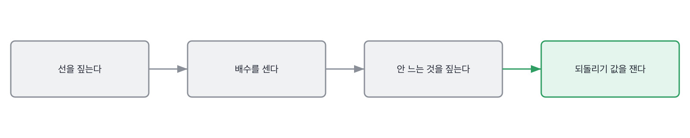
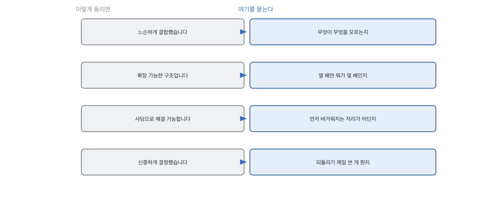

# 14장을 닫으며

## 한 관문을 닫으며

세 칸이 그림 하나를 세 번 다르게 봤습니다. 선, 배수, 그리고 되돌리기 값이요.
셋을 한 줄로 이으면 이렇게 됩니다. **이 사람이 이 그림을 고쳐 본 적이 있는가.**
처음 그린 그림과 두 번 고친 그림은 다르게 생겼는데, 말로는 똑같이 들립니다.

설계 답변에서 제일 조심할 낱말은 확장성입니다. 이 낱말은 아무 말도 안 하면서
무언가 말한 것처럼 들리거든요. 확장 가능한 구조라는 문장에는 무엇이 몇 배가 되는지가 없어요.
그래서 저는 그 낱말이 나오면 배수를 묻습니다. 배수를 대면 그때부터 이야기가 시작됩니다.

설계 자리에서 자주 들리는 말과 그때 물을 자리를 짝으로 세우면 이렇게 됩니다.
왼쪽 넷은 다 통과되는 문장이고, 오른쪽을 한 번씩만 물으면 그 자리에서 갈려요.

설계 자리에서 자주 들리는 말과 그때 물을 자리를 짝으로 세우면 이렇게 됩니다.

> **저자의 삽질**
>
> 그림이 촘촘하면 넓게 보는 사람으로 읽힙니다. 상자가 많고 화살표가 예쁘면 더 그렇고요.
> 저도 완성도를 보고 있던 때가 있었습니다. 그런데 만들어 본 사람은 상자가 줄어요.
> 안 만들어도 되는 것을 지워 봤기 때문입니다. 설계는 늘리는 일이 아니라 지우는 일이거든요.

상자 개수 이야기를 한 번 더 하고 싶습니다. 저는 셋에서 다섯 사이를 봅니다.
일곱 개 넘게 그리는 사람은 대개 아직 안 만들어 본 사람이에요.
만들어 보면 상자가 줄거든요. 안 만들어도 되는 것을 지워 봤기 때문입니다.
**그림의 값은 그린 상자가 아니라 안 그린 상자에 있습니다.**

그리고 하나 더. 설계 질문은 45분 중에 10분을 넘기지 마세요.
그림은 오래 그릴수록 좋아 보이는데, 좋아 보이는 것과 확인되는 것은 다릅니다.
선 하나와 배수 하나와 되돌리기 값 하나면 10분에 다 나옵니다. 그 뒤로는 그림만 예뻐져요.

> **30초 점검**
>
> 상자를 다섯 이하로 그리는가.
> 선 하나를 짚고 무엇이 무엇을 모르는지 말하는가.
> 열 배일 때 무엇이 몇 배인지 값으로 대는가.
> 안 늘어나는 것도 하나 짚는가.
> 되돌리기 제일 싼 결정과 제일 비싼 결정을 가르는가.

이 장에서 나온 낱말 몇 개를 짚고 갑니다. 설계 면접을 팀에서 부르는 말들이에요.
큰 조직에서 온 분들에게는 익숙하고, 작은 팀에서는 안 쓰는 말들입니다.
말이 없어도 그 일은 하고 있으니 이름만 알아 두시면 됩니다.

> **채용 말 배우기**
>
> **시스템 디자인 라운드** 설계만 보는 라운드를 말합니다. 대개 45분에 한 문제입니다.
>
> **바 레이저** 그 팀 사람이 아닌 면접관이 기준을 맞추러 들어오는 자리를 말해요.
>
> **스코프** 이 라운드에서 어디까지 볼지 미리 정해 둔 범위를 말합니다. 안 정하면 다 훑게 됩니다.

옛 관행 하나를 재 봅니다. 화이트보드에 시스템을 그리게 하던 관행이에요.

> **옛 규칙은 아직 유효한가**
>
> **화이트보드 시스템 설계.** 판정은 조정해서 유효입니다.
> 근거는 제 경험이에요. 그림 자체는 이제 누구나 그럴듯하게 그립니다.
> 그래서 저는 그리게 한 다음 **선 하나를 옮겨 보라**고 합니다.
> 옮기면 무엇이 깨지는지를 대는 사람과 그냥 옮기는 사람이 그 자리에서 갈립니다.

다음 장은 운영입니다. 지금까지는 그리고 만들고 재는 이야기였어요.
이제 그게 밖에 나가서 돌기 시작한 뒤의 이야기를 봅니다. 거기서부터는 아무도 안 보고 있을 때가 많습니다.

설계 이야기를 들을 때 제가 하는 것을 하나 더 적어 둡니다.

> **현장에서는**
>
> 저는 상자를 다 그리고 나면 하나를 지워 달라고 합니다. 없어도 되는 걸 하나 골라 달라고요.
> 못 고르는 사람이 절반입니다. 만들어 본 사람은 대개 바로 하나를 짚습니다.

속기 쉬운 자리를 둘 짚습니다. 설계 답변에서 제일 자주 나오는 것들이에요.
하나는 상자를 많이 그리는 자리이고 다른 하나는 확장성이라는 낱말입니다.
둘 다 나쁜 뜻이 아니라서 그냥 넘어가기 쉽습니다.

> **여기서 다들 속는다**
>
> 상자를 많이 그리면 시스템을 넓게 보는 것처럼 느껴집니다. 실제로 넓게 보고 있기도 하고요.
> 그런데 상자 개수는 읽은 양에 비례합니다. 참고 그림에 있는 걸 다 넣으면 많아져요.
> 만들어 본 사람은 상자가 줄어듭니다. 안 만들어도 되는 걸 지워 봤기 때문입니다.
> 확인은 지우라고 하면 됩니다. 없어도 되는 상자를 하나 골라 달라고요.

둘째는 낱말 하나입니다. 설계 답변에서 제일 자주 나오고 제일 아무 말도 안 하는 낱말이요.

> **여기서 다들 속는다**
>
> 확장 가능한 구조라는 말은 앞을 내다본 것처럼 들립니다. 나쁜 뜻이 아니고요.
> 그런데 이 문장에는 무엇이 몇 배가 되는지가 없습니다. 배수가 없으면 대비할 자리도 없어요.
> 열 배가 됐을 때 무엇이 먼저 버거워지는지는 자기 코드를 읽어야만 답이 나옵니다.
> 확인은 배수를 물으면 됩니다. 문서가 열 배면 질의 하나에 드는 일이 몇 배냐고요.

마지막 칸에서 못 다 한 이야기를 하고 닫겠습니다.

> **쉬어 가기**
>
> **쉬어 가기: 되돌릴 수 있게 만드는 일**
>
> 이 관문의 마지막 칸이 되돌리기 값이었는데, 거기서 못 다 한 이야기를 여기서 합니다.
>
> 되돌리기 값을 아는 것과 값을 낮추는 것은 다른 일입니다.
> 아는 건 재면 되고, 낮추는 건 만들어야 해요. 그리고 낮추는 쪽이 훨씬 값집니다.
>
> 색인을 옆에 하나 더 만드는 이야기가 그 예였습니다. 옛것을 안 지우면
> 되돌리기 값이 조각 210개에서 0으로 떨어집니다. 지우기만 하면 되니까요.
> 대신 잠깐 두 벌을 들고 있어야 하고, 그만큼 자리를 더 씁니다.
>
> 이 맞바꿈이 설계에서 제일 자주 나오는 모양입니다. 지금 조금 더 쓰고 나중에 싸게 되돌리기요.
> 그리고 이걸 실제로 해 본 사람은 반드시 **한 번 크게 못 되돌려 본** 사람입니다.
> 안 겪으면 지금 조금 더 쓰는 게 아까워서 안 하거든요.
>
> 그래서 저는 이 자리를 물을 때 값을 묻지 않고 방법을 묻습니다.
> 그 비싼 결정을 어떻게 되돌릴 수 있게 만드셨냐고요.
> 방법이 나오면 그 사람은 한 번 겪은 사람입니다. 값만 아는 사람과 거기서 갈립니다.

긴 이야기는 여기까지입니다. 설계 자리에서 들고 갈 것을 다섯 줄로 접으면 이렇게 됩니다.
상자가 아니라 선을 보라는 게 다섯 줄의 요지예요.

> **한 관문 요약**
>
> 상자 이름은 어느 그림에나 있습니다. 선을 짚게 하고 무엇이 무엇을 모르는지 받으세요.
>
> 느슨하다는 낱말 대신 모른다는 동사가 나오면 그어 본 사람입니다.
>
> 대책 이름은 검색되고 배수는 안 검색됩니다. 몇 배가 되는지를 먼저 받으세요.
>
> 안 늘어나는 것을 같이 대면 두 번 이상 세어 본 사람입니다.
>
> 되돌리기 값을 아는 사람은 싼 결정과 비싼 결정을 다른 속도로 다룹니다.
>
> 다음 관문에서 뒤집히는 것. 그리고 만드는 자리에서 나가서 도는 것을 지켜보는 자리로 넘어갑니다.

> **이 판정이 헐거운 지점**
>
> 상자 다섯이라는 기준은 제가 세어 본 것이 아니라 제 습관입니다.
>
> 설계를 남이 해 주는 팀에서 온 사람은 선을 옮겨 본 적이 없을 수 있습니다. 그게 실력은 아니에요.
>
> 되돌리기 값을 조각 수로 적는 방식은 이 책의 과제에서만 깔끔합니다. 밖에서는 더 지저분합니다.
