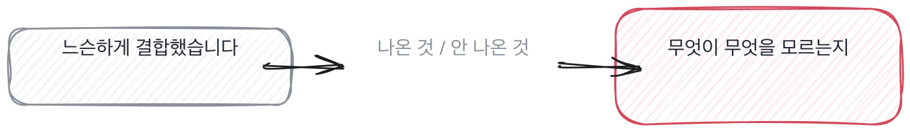

# 14.1 그림을 그리게 한다

*[13.3](../13-g13/q045.md) 까지가 잰 이야기였죠. 이번엔 그 시스템을 그림으로 그리게 합니다.*

> **이 말부터**
>
> **경계** 두 상자 사이에 그은 선을 말합니다. 이쪽이 저쪽을 모르게 만드는 자리예요.
>
> **그림** 화이트보드에 상자와 화살표로 그린 것을 말합니다. 문서가 아니라 그 자리에서 그린 것이요.

설계를 물으면 그림이 나옵니다. 그런데 그림은 준비가 잘 됩니다.
상자 이름은 외울 수 있고, 화살표 방향은 어느 서비스나 비슷하고, 그럴듯하게 보이거든요.
**그래서 저는 상자를 안 봅니다.** 선을 봅니다.

선이 다른 이유는 상자가 다른 이유보다 좁습니다. 상자는 다들 비슷하게 그려요.
게이트웨이가 있고 서버가 있고 저장소가 있죠. 그런데 선은 사람마다 다른 데 그어져 있습니다.
그리고 선을 옮겨 본 사람만 왜 거기 그었는지를 말할 수 있어요.

이 책의 검색 서비스에도 선이 하나 있습니다. 자르는 규칙과 색인 사이입니다.
지금 코드는 색인이 자르는 법을 알고 있어요. 색인한테 문서를 주면 알아서 자릅니다.
선을 밖으로 옮기면 이렇게 됩니다.

```python
def index_outside(docs: dict[str, str]) -> Index:
    """밖에서 자르고 조각만 넣는다. 색인은 자르는 법을 모른다."""
    index = Index()
    for doc_id, text in docs.items():
        for chunk in split(doc_id, text, size=30, overlap=5):
            index.add(chunk)
    return index
```

두 코드는 지금 완전히 같은 결과를 냅니다. 조각 순서까지 같아요.
그러니까 오늘은 어느 쪽이든 상관이 없습니다. 이게 경계 이야기의 시작점입니다.
**경계는 오늘 결과를 안 바꾸고 내일 바꿀 수 있는 것을 바꿉니다.**

공지 문서가 들어와서 종류마다 다르게 잘라야 하는 날이 오면 갈립니다.
밖에 그어 둔 쪽은 자르는 표만 고치면 되고, 안에 둔 쪽은 색인을 고쳐야 해요.
그날이 오기 전에는 둘이 똑같아 보입니다. 그래서 물어야 알 수 있습니다.

> **이렇게 답합니다**
>
> 전체적으로 API 게이트웨이, 애플리케이션 서버, 벡터 데이터베이스,
> 그리고 LLM 서빙 레이어로 구성됩니다.
> 각 컴포넌트는 느슨하게 결합되어 확장성을 확보했습니다.
> 필요에 따라 캐싱 레이어와 큐를 추가할 수 있습니다.

상자 이름이 넷 나왔습니다. 넷 다 어느 서비스 그림에나 있는 상자예요.

> **표시해 보면**
>
> 전체적으로 API 게이트웨이, 애플리케이션 서버, 벡터 데이터베이스,
>     ← 어느 그림에나 있는 상자들. 이 서비스만의 것이 없음
> 그리고 LLM 서빙 레이어로 구성됩니다.
>     ← 상자 이름만 있음. 상자 사이에 무엇이 오가는지 없음
> 각 컴포넌트는 느슨하게 결합되어 확장성을 확보했습니다.
>     ← 느슨하다는 근거 없음. 무엇이 안 걸려 있는지 없음
> 필요에 따라 캐싱 레이어와 큐를 추가할 수 있습니다.
>     ← 아직 안 그은 선. 지금 그림이 아님

첫 두 줄에 이 서비스만의 것이 하나도 없습니다. 상자 이름만 있고 사이에 무엇이 오가는지가 없어요.
셋째 줄의 느슨하게 결합되어가 이 답에서 제일 미끄러운 자리입니다.
**무엇이 무엇을 모르는지를 대야 느슨한 건데, 그게 없거든요.**
넷째 줄은 아직 안 그은 선 이야기입니다. 지금 그림을 물었는데 앞으로 그릴 그림이 왔어요.

> **이렇게 파고듭니다**
>
> 물음: 자르는 규칙은 그 상자 중에 어디에 있어요?
>
> 답: 전처리 파이프라인 단계에서 처리되는 것으로 이해하고 있습니다.

이해하고 있다는 말이 나오면 거기서 정해집니다. 자기가 그은 선이 아니라는 뜻이거든요.
그은 사람은 어느 상자 안인지를 바로 댑니다. 자기가 넣은 자리니까요.

> **그어 본 사람이면**
>
> 상자는 셋이에요. 자르는 쪽, 색인, 그리고 답 만드는 쪽입니다.
> 선은 자르기와 색인 사이에 그었어요. 색인은 자르는 법을 모릅니다.
> 처음엔 색인 안에 있었는데, 공지 문서가 들어오면서 다르게 잘라야 했거든요.
> 그때 밖으로 뺐습니다. 안 뺐으면 색인을 고쳐야 했어요.

첫 줄에 상자가 셋으로 줄었습니다. 셋은 적은 숫자예요. 적게 그린 사람이 대개 그려 본 사람입니다.
둘째 줄이 선입니다. 색인은 자르는 법을 모른다고 하죠. 무엇이 무엇을 모르는지가 여기서 나와요.
**느슨하다는 낱말 대신 모른다는 동사를 쓴 겁니다.**



셋째 줄과 넷째 줄이 짝입니다. 처음엔 안에 있었는데 공지 문서 때문에 밖으로 뺐다고 합니다.
[8.2](../08-g08/q028.md) 에서 되돌린 이야기를 물었던 그 자리가 설계에서는 선을 옮긴 이야기로 나옵니다.
선을 옮겨 본 사람은 그 선이 왜 거기 있는지를 압니다. 옮겨 보기 전에는 아무도 몰라요.

> **판정**
>
> 상자를 서넛으로 줄여 그리고, 선 하나를 짚어 무엇이 무엇을 모르는지 말하면 통과입니다.
> 그 선을 옮겨 본 이야기까지 나오면 아주 좋은 신호예요.
>
> 상자 이름만 늘어놓고, 선이 어디냐고 물어도 느슨하게 결합했다거나 파이프라인 단계에서
> 처리된다는 식으로만 답하면 다음 라운드로 안 보냅니다.
>
> 기록에는 이렇게 적습니다. 상자를 셋으로 그리고 자르기와 색인 사이에 선을 그었으며,
> 색인이 자르는 법을 모른다고 설명했고, 공지 문서가 들어오면서 그 선을 밖으로 옮겼다고 말했다.

> **물을 문장 둘**
>
> 그림을 그려 달라고 하면 상자가 옵니다. 상자는 준비할 수 있어요. 그래서 선을 묻습니다.
> 선을 짚으면 무엇이 무엇을 모르는지가 따라 나오고, 그 모름이 실제로 나눠 본 사람의 표시입니다.
>
> **그대로 읽으세요.** *그 상자들 사이에 선을 하나만 짚어 주세요. 어디예요?*
>
> **답을 받으면 이어서.** *그 선 왼쪽이 오른쪽의 뭘 모르죠? 그 선을 옮겨 본 적 있어요?*

> **이걸 놓치면**
>
> 선을 못 받으면 [14.2](q047.md) 에서 열 배를 물어도 어느 상자가 커지는지 짚을 데가 없습니다.

