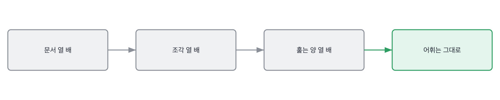

# 14.2 열 배가 되면 어디가 먼저 터지나

*[14.1](q046.md) 에서 선을 받았죠. 이번엔 그 선 안쪽이 열 배가 되면 어디가 버거워지는지 봅니다.*

> **이 말부터**
>
> **먼저 버거워지는 자리** 규모가 커질 때 제일 먼저 못 버티는 곳을 말합니다. 대개 하나입니다.
>
> **선형** 입력이 열 배면 일도 열 배가 되는 것을 말해요. 일이 그대로면 선형이 아닙니다.

규모를 물으면 대책이 옵니다. 샤딩, 레플리카, 캐시, 오토스케일링.
넷 다 실제로 쓰는 말이고 넷 다 맞는 대책이에요. 그런데 넷 다 검색하면 나옵니다.
**대책의 이름은 준비되고, 무엇이 몇 배가 되는지는 준비가 안 됩니다.**

몇 배가 되는지를 말하려면 자기 코드가 무엇을 하는지 알아야 하거든요.
질의 하나가 들어오면 어디를 몇 번 훑는지요. 이건 남의 글에 안 적혀 있습니다.
자기 코드에만 적혀 있어요.

이 책의 검색 서비스로 열 배씩 키워 봤습니다. 문서 다섯 개에서 오백 개까지요.

돌려 보면 이렇게 나옵니다. 문서를 열 배씩 두 번 늘려 세었습니다

```
문서    조각    질의 하나에 점수 매기는 조각    어휘
5       21      21                        120
50      210     210                       120
500     2100    2100                      120

되돌리려면 다시 만들 조각 (문서 50개 기준)
  top_k 를 3에서 5로         0
  겹침을 5에서 10으로           210
  청크를 30에서 40으로          210
  낱말 자르는 규칙 교체           210
```

문서가 백 배면 조각도 백 배입니다. 21개에서 2100개가 됐어요.
그리고 질의 하나에 점수를 매기는 조각 수가 조각 수와 똑같습니다.
**거르는 단계가 없어서 전부 훑거든요.** 이게 이 코드의 성질이고, 코드를 읽어야 아는 성질입니다.

그런데 어휘는 안 늘었습니다. 120에서 120이에요. 같은 문서를 여러 벌 넣었으니까요.
어휘가 안 늘면 메모리는 안 늘고, 훑는 양만 늡니다.
그러니까 먼저 버거워지는 건 저장소가 아니라 질의 하나가 하는 일입니다.



여기서 대책이 정해집니다. 저장소를 늘리는 게 아니라 앞에서 후보를 줄여야 해요.
캐시도 답이 아닙니다. 같은 질의가 자주 와야 캐시가 사는데, 그건 따로 재 봐야 압니다.
**대책은 먼저 버거워지는 자리를 짚은 다음에 고르는 것입니다.** 순서가 반대면 아무거나 붙게 돼요.

> **이렇게 답합니다**
>
> 트래픽이 증가하면 데이터베이스 부하가 가장 먼저 문제가 될 것 같습니다.
> 샤딩과 레플리카를 통해 수평 확장하면 해결할 수 있습니다.
> 캐시를 도입해 반복 요청을 줄이는 것도 방법입니다.
> 오토스케일링을 적용하면 트래픽 급증에도 대응 가능합니다.

첫 줄에서 이미 갈립니다. 문서를 물었는데 트래픽으로 바꿔 답했어요.

> **표시해 보면**
>
> 트래픽이 증가하면 데이터베이스 부하가 가장 먼저 문제가 될 것 같습니다.
>     ← 물은 건 문서 수인데 트래픽으로 바꿔 답함
> 샤딩과 레플리카를 통해 수평 확장하면 해결할 수 있습니다.
>     ← 대책 이름. 무엇이 몇 배가 되는지 없음
> 캐시를 도입해 반복 요청을 줄이는 것도 방법입니다.
>     ← 같은 질의가 얼마나 오는지 모르는 채로 말함
> 오토스케일링을 적용하면 트래픽 급증에도 대응 가능합니다.
>     ← 여전히 트래픽 이야기. 문서가 늘 때의 이야기가 없음

넷 중 셋이 트래픽 이야기입니다. 문서가 느는 것과 요청이 느는 것은 다른 일인데요.
문서가 늘면 질의 하나가 무거워지고, 요청이 늘면 질의 개수가 많아집니다. 대책이 서로 다릅니다.
**셋째 줄의 캐시는 같은 질의가 얼마나 오는지 모르는 채로 나온 대책이고요.**
넷째 줄까지 와도 문서가 늘 때의 이야기는 한 줄도 없습니다.

> **이렇게 파고듭니다**
>
> 물음: 문서가 열 배면 질의 하나에 드는 일은 몇 배가 되나요?
>
> 답: 인프라 구성에 따라 달라질 수 있을 것 같습니다.

인프라에 따라 달라진다는 답은 이 질문에 안 맞습니다. 코드가 무엇을 하는지를 물었거든요.
전부 훑는 코드는 어느 인프라에 올려도 전부 훑습니다.

> **세어 본 사람이면**
>
> 질의 하나에 조각을 전부 훑거든요. 그래서 문서가 열 배면 훑는 것도 열 배입니다.
> 조각 210개에서 2100개가 되는 거요. 어휘는 안 늘어요. 같은 문서라서 120개 그대로였습니다.
> 그러니까 메모리보다 훑는 쪽이 먼저 버거워집니다.
> 그래서 다음에 붙일 건 캐시가 아니라 앞에서 후보를 줄이는 단계입니다.

첫 줄에 코드의 성질이 나옵니다. 조각을 전부 훑는다고요.
둘째 줄에 숫자가 둘 나오고요. 210에서 2100으로, 그리고 어휘는 120 그대로.
**안 늘어난 숫자를 같이 대는 게 이 답의 값입니다.** [13.2](../13-g13/q044.md) 에서 배운 그 손이에요.

셋째 줄이 결론이에요. 메모리보다 훑는 쪽이 먼저 버거워진다고 합니다.
넷째 줄에서 대책이 나오는데, 캐시가 아니라 후보를 줄이는 단계입니다.
먼저 버거워지는 자리를 짚었으니 대책이 그 자리로 갑니다. 순서가 맞은 겁니다.

> **현장에서는**
>
> 저는 열 배를 물을 때 종이에 숫자 두 개만 적어 달라고 합니다.
> 지금 값과 열 배일 때의 값이요. 적으라고 하면 못 적는 사람이 절반입니다.

배수 이야기는 여기까지입니다. 몇 배인지와 안 늘어나는 게 뭔지, 둘이면 충분해요.
그 둘이 나오면 대책은 저절로 그 자리로 갑니다.

> **판정**
>
> 무엇이 몇 배가 되는지를 값으로 대고, 안 늘어나는 것도 하나 짚으면 통과입니다.
> 그래서 대책이 그 자리로 가면 아주 좋은 신호예요.
>
> 샤딩이나 캐시 같은 대책 이름만 대고, 몇 배가 되냐고 물어도 인프라에 따라 다르다거나
> 상황에 따라 달라진다고 답하면 다음 라운드로 안 보냅니다.
>
> 기록에는 이렇게 적습니다. 질의 하나가 조각을 전부 훑는다는 것을 짚고 210에서 2100으로
> 열 배가 되는 것을 댔으며, 어휘는 120에서 안 는다는 것까지 말해 대책을 후보 줄이기로 골랐다.

> **물을 문장 둘**
>
> 규모를 물으면 대책이 옵니다. 대책은 검색되고 배수는 안 검색돼요. 그래서 배수를 묻습니다.
> 배수를 대면 코드가 무엇을 하는지가 따라 나오고, 그게 자기 코드를 읽었다는 표시입니다.
>
> **그대로 읽으세요.** *문서가 열 배면 질의 하나에 드는 일은 몇 배가 되나요?*
>
> **답을 받으면 이어서.** *그때 안 늘어나는 건 뭐죠? 그럼 뭘 먼저 붙이실 거예요?*

> **이걸 놓치면**
>
> 배수를 못 받으면 [15.2](../15-g15/q050.md) 에서 조용히 나빠지는 것을 물어도 무엇을 볼지 못 정합니다.

