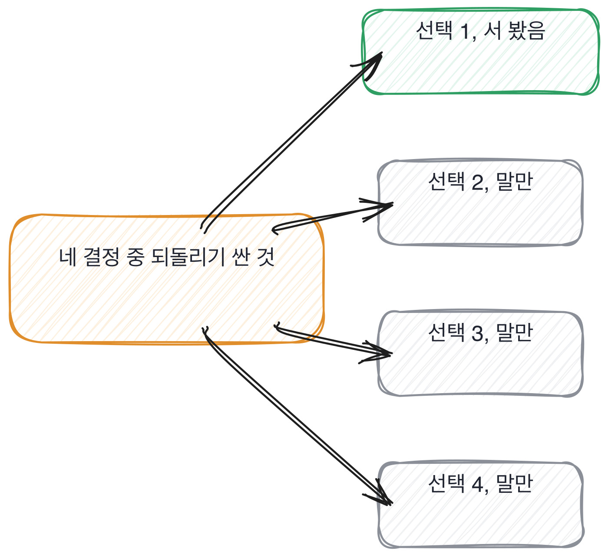

# 14.3 되돌릴 수 있는 결정과 없는 결정

*[14.2](q047.md) 에서 배수를 받았죠. 이번엔 그 결정들을 되돌리는 값이 얼마인지 봅니다.*

> **이 말부터**
>
> **되돌리기 값** 그 결정을 물리려면 무엇을 얼마나 다시 만들어야 하는지를 말합니다.
>
> **싼 결정** 되돌리는 데 아무것도 안 드는 결정이에요. 그래서 먼저 흔들어 봅니다.

설계에서 제일 값진 구분은 좋은 결정과 나쁜 결정이 아닙니다. 싼 결정과 비싼 결정이에요.
좋고 나쁨은 해 봐야 알고, 싸고 비쌈은 하기 전에 압니다.
**그래서 일 잘하는 사람은 싼 걸 먼저 흔들고 비싼 건 미룹니다.**

이 순서를 아는지가 이 칸에서 갈립니다. 순서를 아는 사람은 되돌려 봤어요.
되돌려 보면 값이 몸에 남거든요. 재색인 한 번 돌려 본 사람은 그 값을 안 잊습니다.
안 해 본 사람은 결정을 다 같은 무게로 다룹니다. 그래서 전부 신중하게 합니다.

되돌리기 값을 어떻게 적을지가 문제인데, 시간이나 돈으로 적으면 환경마다 다릅니다.
그래서 저는 **다시 만들어야 하는 조각 수**로 적습니다. 어디서 돌려도 같은 값이 나와요.
이 책의 검색 서비스에 네 결정을 놓고 세어 보면 이렇게 됩니다.

```python
DECISIONS: tuple[Decision, ...] = (
    Decision("top_k 를 3에서 5로", rebuilds_chunks=False, invalidates_cache=True),
    Decision("겹침을 5에서 10으로", rebuilds_chunks=True, invalidates_cache=True),
    Decision("청크를 30에서 40으로", rebuilds_chunks=True, invalidates_cache=True),
    Decision("낱말 자르는 규칙 교체", rebuilds_chunks=True, invalidates_cache=True),
)
```

top\_k 는 값만 바꾸면 됩니다. 되돌리는 데 조각을 하나도 다시 안 만들어요.
겹침과 청크 크기와 낱말 자르는 규칙은 다릅니다. 셋 다 조각을 전부 다시 만들어야 합니다.
문서 쉰 개면 210개 전부요. 이게 하나와 셋을 가르는 선입니다.



선이 어디 있는지 보면 재미있습니다. 조각을 건드리느냐 아니냐예요.
조각을 안 건드리는 결정은 그날 세 번도 바꿉니다. 건드리는 결정은 두 주에 한 번 바꾸고요.
같은 코드 안에 사는 결정인데 다루는 속도가 다릅니다.

> **이렇게 답합니다**
>
> 설계 단계에서 신중하게 검토하여 되돌릴 일이 없도록 했습니다.
> 확장성과 유지보수성을 고려해 의사결정을 진행했습니다.
> 문서화를 통해 의사결정 배경을 공유했습니다.

첫 줄이 이 답을 정합니다. 되돌릴 일이 없도록 했다는 말이거든요.

> **표시해 보면**
>
> 설계 단계에서 신중하게 검토하여 되돌릴 일이 없도록 했습니다.
>     ← 되돌린 적이 없다는 말. 그런 프로젝트는 드물다
> 확장성과 유지보수성을 고려해 의사결정을 진행했습니다.
>     ← 고려의 내용이 없음. 무엇을 내줬는지 없음
> 문서화를 통해 의사결정 배경을 공유했습니다.
>     ← 적었다는 말. 되돌린 값이 얼마인지는 여전히 없음

되돌린 적 없는 프로젝트를 저는 아직 못 봤습니다. 없는 게 아니라 안 말하는 거예요.
둘째 줄의 확장성과 유지보수성은 [10.3](../10-g10/q035.md) 에서 본 그 자리입니다. 내준 것이 안 나오는 자리요.
**셋째 줄은 적었다는 말인데, 적은 것과 되돌린 것은 다른 일입니다.**

> **이렇게 파고듭니다**
>
> 물음: 그럼 되돌리기 제일 쌌던 건 뭐였어요?
>
> 답: 대부분의 결정은 조정이 가능한 수준이었습니다.

여기서 방향을 바꿔 물은 게 보이실 겁니다. 제일 비싼 것 대신 제일 싼 것을 물었어요.
비싼 것을 못 대는 사람은 싼 것도 못 댑니다. 값이라는 잣대 자체가 없거든요.

> **되돌려 본 사람이면**
>
> top_k 는 값만 바꾸면 돼서 되돌리는 데 아무것도 안 듭니다.
> 청크 크기는 다르죠. 바꾸면 조각을 전부 다시 만들어야 해요. 210개 전부요.
> 그래서 청크는 두 주 뒤에 바꿨고 top_k 는 그날 세 번 바꿨습니다.
> 싼 걸 먼저 흔들어 보고 비싼 건 뒤로 미룬 거예요.

첫 줄과 둘째 줄이 값입니다. 아무것도 안 드는 것과 210개 전부를 다시 만드는 것.
셋째 줄이 그 값을 행동으로 옮긴 자리예요. 청크는 두 주 뒤에, top\_k 는 그날 세 번.
**값을 아는 사람은 두 결정을 다른 속도로 다룹니다.** 이건 말로만 아는 사람이 못 하는 일입니다.

> **한 번 더**
>
> 그 비싼 결정을 결국 어떻게 했냐고 물으면 절차가 한 번 더 보입니다.
> 점진적으로 마이그레이션을 진행하여 리스크를 최소화했습니다.
> 점진적으로라는 낱말에는 순서가 없습니다. 되돌릴 지점이 어디였는지도 없고요.
> 반대쪽은 새 색인을 옆에 만들고 옛것을 안 지웠다고 말합니다. 그게 되돌릴 지점이거든요.

새 색인을 옆에 만든다는 문장이 이 칸의 끝입니다. 비싼 결정을 싼 결정으로 바꾸는 방법이에요.
옛것을 남겨 두면 되돌리기 값이 210개에서 0으로 떨어집니다. 지우기만 하면 되니까요.
**비싼 결정을 잘 하는 게 아니라 싸게 만드는 것이 이 자리의 기술입니다.**

그리고 그다음 세 줄이 좋습니다. 질의를 양쪽에 다 보내고 결과가 다른 것만 스무 개 읽었다고 하죠.
그중 셋이 새 쪽이 나빴는데 다 표가 든 문서였고요. 그래서 표 있는 문서만 옛 크기로 뒀다고 합니다.
[11.2](../11-g11/q037.md) 에서 깨진 단계를 좁히던 손이 여기서는 옮길 것과 안 옮길 것을 가르는 손이 됩니다.

> **판정**
>
> 되돌리기 값을 둘 이상 대고 그 값에 따라 다른 속도로 다뤘다고 말하면 통과입니다.
> 비싼 결정을 싸게 만든 이야기까지 나오면 아주 좋은 신호예요.
>
> 되돌릴 일이 없도록 신중히 했다고 하고, 제일 싼 결정을 물어도 대부분 조정 가능했다고
> 답하면 다음 라운드로 안 보냅니다. 값 대신 절차 이름만 대도 같습니다.
>
> 기록에는 이렇게 적습니다. top\_k 는 되돌리는 데 아무것도 안 들고 청크 크기는 조각 210개를 다시 만들어야
> 한다는 것을 값으로 댔으며, 새 색인을 옆에 만들어 되돌릴 지점을 남기고 옮겼다고 말했다.

> **물을 문장 둘**
>
> 결정을 물으면 신중했다는 말이 옵니다. 신중은 값이 없어요. 그래서 되돌리기 값을 묻습니다.
> 값을 대면 어느 결정을 먼저 흔들었는지가 따라 나오고, 그 순서가 되돌려 본 사람의 표시입니다.
>
> **그대로 읽으세요.** *그 결정들 중에 되돌리기 제일 쌌던 게 뭐예요?*
>
> **답을 받으면 이어서.** *제일 비쌌던 건요? 그건 어떻게 되돌릴 수 있게 만드셨죠?*

> **이걸 놓치면**
>
> 되돌리기 값을 못 받으면 [15.4](../15-g15/q052.md) 에서 틀린 답이 나갔을 때를 물어도 되돌릴 지점이 안 나옵니다.

