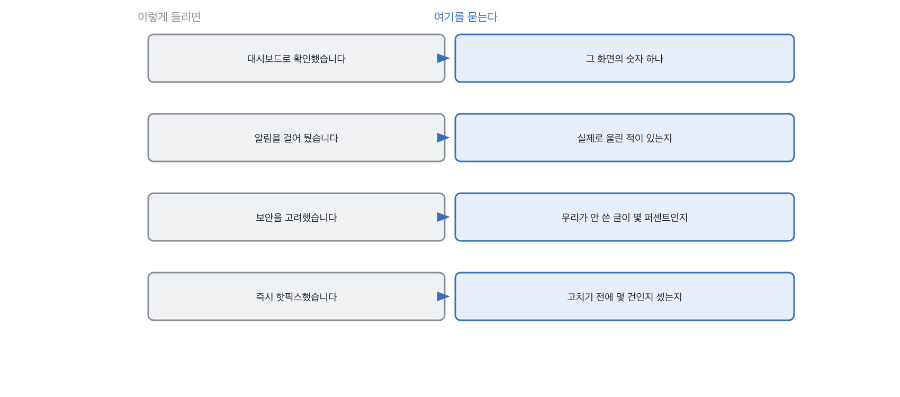

# 15장을 닫으며

## 한 관문을 닫으며

네 칸이 같은 자리를 네 번 팠습니다. **지켜본다는 말과 실제로 보인 것 사이**요.
지켜본다는 말은 장치 이야기라 안 겪어도 할 수 있습니다. 그럴듯하게 그릴 수 있고요.
보인 것은 다릅니다. 그날 무엇이 화면에 있었고 무엇이 없었는지는 그 자리에 있던 사람만 압니다.

운영 답변에서 제일 조심할 문장은 알림이 안 울렸다는 말입니다.
이 문장은 두 가지를 뜻할 수 있어요. 아무 일도 없었거나, 그 일이 알림에 안 걸렸거나요.
**그리고 둘은 밖에서 보면 똑같이 생겼습니다.** 그래서 실제로 울린 적을 묻습니다.

운영 자리에서 자주 들리는 말과 그때 물을 자리를 짝으로 세우면 이렇게 됩니다.
왼쪽 넷은 다 통과되는 문장이고, 오른쪽을 한 번씩만 물으면 그 자리에서 갈려요.

> **저자의 삽질**
>
> 사고 이야기가 원인에서 대책까지 매끄럽게 이어지면 잘 겪은 사람으로 읽힙니다.
> 저도 대책의 품질만 듣고 있던 때가 있었고요. 그런데 실제 사고에서 갈리는 건 순서입니다.
> 먼저 세지 않고 고치면 몇 건에 나갔는지는 영영 모릅니다. 매끄러운 이야기 안에서는 그 순서가 안 보여요.

숫자를 붙이는 이야기를 한 번 더 하고 싶습니다. 이 장의 네 칸이 전부 세는 이야기인데,
세는 것 자체는 어렵지 않아요. 열 줄이면 됩니다. 어려운 건 무엇을 셀지 정하는 일입니다.
그리고 무엇을 셀지는 **한 번 놓쳐 봐야** 정해집니다.

그래서 저는 이 장의 질문들을 지원자를 시험하는 데 안 씁니다. 겪었는지를 보는 데 씁니다.
안 겪었으면 못 대는 게 당연하고, 그건 실력이 아니라 자리의 문제예요.
다만 겪은 사람과 안 겪은 사람에게 맡길 범위가 다르고, 그걸 정하는 게 면접관의 일입니다.

이 구분을 두면 판정이 편해집니다. 못 댄 사람을 떨어뜨리는 게 아니라
운영을 맡길 자리가 아니라고 적으면 되거든요. [18.1](../18-g18/q059.md) 에서 그 등급을 다시 다룹니다.

> **30초 점검**
>
> 자기 서비스에만 있는 숫자를 하나 이상 대는가.
> 알림이 못 잡은 사건을 하나 대는가.
> 맥락에 들어가는 글 중 우리가 안 쓴 것의 비율을 아는가.
> 틀린 답이 나갔을 때 세는 일이 고치는 일보다 먼저인가.
> 회고에서 정한 것 중 지금 도는 것을 하나 대는가.

이 장에서 나온 낱말 몇 개를 짚고 갑니다. 운영 이야기를 팀에서 나눌 때 쓰는 말들이에요.
셋 다 겪어 본 사람에게는 설명이 필요 없고, 안 겪은 사람에게는 설명해도 잘 안 와닿습니다.
그래서 이 낱말들이 나오는지가 그 자체로 신호가 되기도 합니다.

> **채용 말 배우기**
>
> **온콜** 사고가 나면 연락받는 당번을 말합니다. 면접에서 이 경험을 물으면 겪은 자리가 나옵니다.
>
> **포스트모템** 사고 뒤에 무슨 일이 있었는지 적는 문서를 말해요. 사람을 탓하지 않는 게 규칙입니다.
>
> **런북** 이런 일이 나면 이렇게 한다고 미리 적어 둔 문서를 말합니다.

옛 관행 하나를 재 봅니다. 장애 대응 경험을 묻던 관행인데, 이건 지금도 잘 듣습니다.

> **옛 규칙은 아직 유효한가**
>
> **장애 대응 경험을 묻는 관행.** 판정은 그대로 유효입니다.
> 근거는 제 경험이에요. 사고 이야기는 지금도 준비가 잘 안 됩니다. 겪어야 나오는 세부가 있거든요.
> 다만 저는 원인 대신 **순서**를 묻는 쪽으로 옮겼습니다.
> 무엇을 먼저 했느냐는 매끄러운 이야기 안에서도 어긋나서, 그 자리에서 잘 갈립니다.

다음 장은 이력서입니다. 지금까지는 이 사람이 만든 것을 봤어요.
이제 그 사람이 자기를 적어 온 종이를 봅니다. 그 종이는 이제 사람이 쓴 게 아닐 수도 있습니다.

운영 이야기를 들을 때 제가 하는 것을 하나 더 적어 둡니다.

> **현장에서는**
>
> 저는 알림 개수를 안 묻고 지난달에 울린 횟수를 묻습니다. 둘이 아주 다른 숫자예요.
> 스무 개를 걸어 뒀는데 지난달에 한 번도 안 울렸다면, 그건 잘 돈 게 아니라 안 걸린 겁니다.

이 관문에서 속기 쉬운 자리를 하나 짚습니다. 사고가 없었다는 답이요.
정말 없었을 수도 있는데, 무엇을 사고로 셀지 안 정해 두면 사고는 원래 안 생깁니다.

> **여기서 다들 속는다**
>
> 사고가 없었다는 답은 안정적으로 운영한 것처럼 들립니다. 실제로 그럴 수도 있고요.
> 그런데 사고는 정의하기 나름입니다. 무엇을 사고로 셀지 정해 두지 않으면 사고가 안 생겨요.
> 정해 둔 팀은 오히려 사고 건수를 정확히 댑니다. 세고 있으니까요.
> 확인은 정의를 물으면 됩니다. 어디까지를 사고로 세시냐고요.

알림에 안 걸린 고장 이야기를 하고 닫겠습니다.
줄일 방법이 사실 없는데, 없다는 걸 아는 것 자체가 면접에서 쓸 자리가 됩니다.

> **쉬어 가기**
>
> **쉬어 가기: 안 걸어 둔 자리에서 나는 고장**
>
> 운영에서 제일 아픈 고장은 알림에 안 걸린 고장입니다. 이건 정의상 그렇습니다.
> 걸어 뒀으면 이미 막았을 테니까요.
>
> 그럼 안 걸어 둔 자리를 어떻게 줄이느냐가 문제가 되는데, 답은 조금 허무합니다.
> 못 줄입니다. 겪기 전에는 어디에 걸어야 할지 모르거든요.
> 알림 목록은 사고 목록의 그림자예요. 사고가 하나 나면 알림이 하나 늘어납니다.
>
> 그래서 운영을 오래 한 팀의 알림 목록을 보면 그 팀이 겪은 일이 보입니다.
> 이상한 알림이 하나 걸려 있으면 그건 반드시 사연이 있는 거예요.
> 맨 위 문서 쏠림을 알림에 걸어 둔 팀이 있다면, 그 팀은 그것 때문에 한 번 데인 겁니다.
>
> 면접에서 이걸 쓰는 방법이 여기서 나옵니다. 알림 목록에서 **제일 이상한 것**을 물어보세요.
> 이상한 걸 하나 대고 왜 걸었는지 말하면, 그 사람은 그 사고를 겪은 사람입니다.
> 목록이 교과서처럼 깔끔하면 그건 아직 아무 일도 안 겪은 목록이고요.
>
> 그리고 이 질문에는 좋은 성질이 하나 더 있습니다. 답하기가 즐겁습니다.
> 사연이 있는 이야기라 지원자도 말하고 싶어 해요. 45분에 그런 질문이 하나 있으면 좋습니다.

긴 이야기는 여기까지입니다. 운영 자리에서 들고 갈 것을 다섯 줄로 접으면 이렇게 됩니다.
걸어 둔 것 말고 안 걸린 것을 묻는 게 공통점이에요.
안 걸린 자리는 겪어야 알게 되고, 그래서 이 관문은 겪었는지를 봅니다.

> **한 관문 요약**
>
> 대시보드는 화면 이름입니다. 그 화면에 있던 숫자 하나를 받으세요.
>
> 알림이 안 울렸다는 말은 안 걸어 뒀다는 뜻일 수 있습니다. 실제로 울린 적을 물으세요.
>
> 지표가 평평한데 답만 바뀌는 날이 있습니다. 그건 사람이 먼저 알려 줍니다.
>
> 맥락의 절반은 우리가 안 쓴 글입니다. 그 비율을 세어 뒀는지가 갈림길이에요.
>
> 틀린 답은 고치는 순간 몇 건인지 못 세게 됩니다. 순서를 물으세요.
>
> 다음 관문에서 뒤집히는 것. 만든 것을 보던 자리에서 자기를 적어 온 종이를 보는 자리로 넘어갑니다.

> **이 판정이 헐거운 지점**
>
> 운영을 안 해 본 사람에게 이 장의 네 칸이 통째로 불리합니다. 자리의 문제이지 실력이 아닙니다.
>
> 맨 위 쏠림을 알림에 걸어 두라는 건 제 습관이지 널리 쓰는 관행이 아닙니다.
>
> 사고 순서를 묻는 방식은 큰 조직에서 절차가 정해진 사람에게 불리할 수 있습니다.
