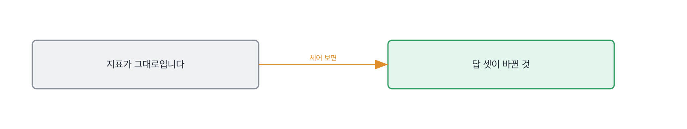

# 15.2 조용히 나빠질 때 무엇으로 아는가

*[15.1](q049.md) 에서 붙여 둔 숫자를 받았죠. 이번엔 그 숫자가 조용할 때를 봅니다.*

> **이 말부터**
>
> **조용한 고장** 지표는 안 움직이는데 답만 바뀌는 것을 말합니다. 알림에 안 걸립니다.
>
> **첫 신고자** 나빠진 걸 제일 먼저 알아챈 쪽을 말해요. 사람일 때가 많습니다.

이 칸이 이 장에서 제일 잘 안 걸리는 자리입니다. 알림을 걸어 뒀다고 하면 다들 넘어가거든요.
그런데 알림은 걸어 둔 것만 울립니다. 안 걸어 둔 자리에서 나는 고장은 조용히 지나가요.
**그리고 진짜 아픈 고장은 대개 안 걸어 둔 자리에서 납니다.** 걸어 뒀으면 이미 막았을 테니까요.

검색에서 조용한 고장이 어떻게 생겼는지 보여드리겠습니다. 어제와 오늘을 나란히 놓은 겁니다.

돌려 보면 이렇게 나옵니다. 어제와 오늘을 같은 잣대로 재고 답까지 견줬습니다

```
날짜  질의  빈 결과  캐시   맨 위 쏠림
어제  8     0.25     0.25   0.5
오늘  8     0.25     0.25   0.667
질의, 빈 결과, 캐시가 어제와 같은가: True

같은 질의인데 맨 위 문서가 바뀐 것
  환불 며칠  refund -> refund-2025
  환불 며칠  refund -> refund-2025
  환불 며칠  refund -> refund-2025

그 문서가 틀렸다면 닿은 건수 5/16 (어제, 오늘)
```

질의 수 여덟, 빈 결과 25퍼센트, 캐시 25퍼센트. 어제와 오늘이 똑같습니다.
대시보드를 보고 있었다면 아무 일도 안 일어난 날이에요. 선이 평평합니다.
그런데 환불 며칠에 대한 맨 위 문서가 세 건 다 바뀌었습니다.



바뀐 방향이 나쁜지 좋은지는 여기서 안 보입니다. 개정본이 올라온 거니까 좋을 수도 있어요.
중요한 건 그게 아닙니다. **바뀌었다는 걸 아무도 몰랐다는 게 중요합니다.**
좋은 쪽으로 바뀌어도 모르면, 나쁜 쪽으로 바뀔 때도 모릅니다.

움직인 숫자가 하나 있긴 합니다. 맨 위 쏠림이 0.5에서 0.667이 됐어요.
한 문서가 절반을 먹다가 셋 중 둘을 먹게 된 겁니다. 이건 걸어 두면 잡힙니다.
다만 이 숫자를 알림에 걸어 두는 팀을 저는 거의 못 봤습니다. 겪기 전에는 안 걸거든요.

> **이렇게 답합니다**
>
> 모니터링 시스템에서 임계치를 설정해 두어 자동으로 감지되도록 했습니다.
> 알림 채널로 즉시 전파되는 구조를 갖췄습니다.
> 이를 통해 장애를 조기에 발견할 수 있었습니다.

세 줄이 다 구조 이야기입니다. 실제로 무슨 일이 있었는지가 한 줄도 없어요.

> **표시해 보면**
>
> 모니터링 시스템에서 임계치를 설정해 두어 자동으로 감지되도록 했습니다.
>     ← 임계치가 무엇에 걸려 있는지 없음. 그 값이 몇인지도 없음
> 알림 채널로 즉시 전파되는 구조를 갖췄습니다.
>     ← 전파 이야기. 무엇이 감지되는지는 여전히 없음
> 이를 통해 장애를 조기에 발견할 수 있었습니다.
>     ← 실제로 발견한 사건이 하나도 없음

첫 줄의 임계치가 무엇에 걸려 있는지 없습니다. 값도 없고요.
둘째 줄은 전파 이야기로 넘어갑니다. 무엇이 감지되는지는 여전히 안 나와요.
**셋째 줄에 실제로 발견한 사건이 하나도 없습니다.** 조기에 발견할 수 있었다는 문장뿐이에요.

> **이렇게 파고듭니다**
>
> 물음: 실제로 그 알림이 울려서 알게 된 적이 있어요?
>
> 답: 알림 자체는 거의 울리지 않을 정도로 안정적이었습니다.

거의 안 울릴 정도로 안정적이었다는 답은 두 가지로 읽힙니다.
정말 안정적이었거나, 안 울리는 자리에 걸어 뒀거나요. 둘을 가르는 건 실제 사건 하나입니다.

> **겪어 본 사람이면**
>
> 상담사 한 분이 답이 이상하다고 했어요. 알림은 안 울렸습니다.
> 숫자는 다 그대로였거든요. 질의 수도 빈 결과 비율도 캐시 비율도요.
> 바뀐 건 답이었어요. 환불 며칠에 개정본이 올라오고 있었습니다.
> 그날부터 같은 질의 스무 개를 매일 돌려서 맨 위가 바뀐 건수를 셉니다.

첫 줄에 사람이 나옵니다. 상담사 한 분이요. 그리고 알림은 안 울렸다고 하죠.
**자기 알림이 못 잡았다고 말하는 사람은 그날을 겪은 사람입니다.**
안 겪은 사람은 알림이 잘 돈다고 말해요. 그게 더 좋아 보이니까요.

둘째 줄에 숫자가 다 그대로였다는 말이 나옵니다. 조용한 고장을 정확히 묘사한 문장이에요.
셋째 줄에 바뀐 것이 나오고, 넷째 줄에 그날 이후에 시작한 일이 나옵니다.
같은 질의 스무 개를 매일 돌려서 맨 위가 바뀐 건수를 센다고 합니다.

지표가 아니라 답을 견주는 장치입니다. [13.2](../13-g13/q044.md) 에서 안 움직인 숫자를 봤던 그 손이
여기서는 안 움직인 지표 뒤를 보는 손이 됐어요. 그리고 이 장치는 겪은 사람만 만듭니다.

> **여기서 다들 속는다**
>
> 알림을 걸어 뒀다는 말은 지켜보고 있다는 말로 들립니다. 실제로 뭔가 돌고 있으니까요.
> 그런데 알림은 걸어 둔 자리만 봅니다. 안 걸어 둔 자리는 지켜보는 게 아니라 안 보는 겁니다.
> 그래서 저는 알림 개수를 안 묻고 실제로 울린 적을 묻습니다.
> 한 번도 안 울렸다는 답이 나오면 그건 자랑이 아니라 확인할 자리입니다.

조용한 고장 이야기는 여기까지입니다. 사건 하나와 그때 알림이 울렸는지, 둘을 봅니다.
그 뒤에 붙인 장치까지 나오면 겪은 사람이에요.

> **판정**
>
> 사람이 먼저 알려 줬다거나 알림이 못 잡았다고 말하고, 그 뒤에 무엇을 붙였는지 대면 통과입니다.
> 지표는 그대로인데 답이 바뀌었다는 구분이 나오면 아주 좋은 신호예요.
>
> 임계치를 걸어 뒀다고만 하고, 실제로 울린 적을 물어도 안정적이라 안 울렸다고 답하면
> 다음 라운드로 안 보냅니다. 사건을 하나도 못 대는 경우도 같습니다.
>
> 기록에는 이렇게 적습니다. 상담사가 먼저 알려 줬고 알림은 안 울렸다고 했으며, 질의 수와
> 빈 결과와 캐시가 다 그대로인데 답만 바뀐 것을 짚고, 매일 스무 개를 돌려 세는 장치를 붙였다.

> **물을 문장 둘**
>
> 알림 이야기를 물으면 구조가 옵니다. 구조는 안 겪어도 그릴 수 있어요. 그래서 사건을 묻습니다.
> 누가 먼저 알려 줬는지를 대면 그날 무엇이 안 걸렸는지가 따라 나옵니다.
>
> **그대로 읽으세요.** *나빠지고 있다는 걸 누가 제일 먼저 알려 줬어요?*
>
> **답을 받으면 이어서.** *그때 알림은 울렸나요? 그 뒤에 뭘 새로 붙이셨죠?*

> **이걸 놓치면**
>
> 첫 신고자를 못 물으면 [15.4](q052.md) 에서 틀린 답 이야기를 해도 언제 알았는지가 안 나옵니다.

