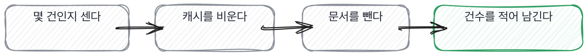

# 15.4 틀린 답이 나갔을 때의 절차

*[15.3](q051.md) 에서 어디서 온 글인지를 봤죠. 이번엔 그 글이 틀린 답을 내보낸 뒤를 봅니다.*

> **이 말부터**
>
> **닿은 건수** 틀린 답이 실제로 몇 사람한테 나갔는지를 말합니다.
>
> **되돌릴 지점** 여기까지는 돌아갈 수 있다고 정해 둔 자리예요. 없으면 못 돌아갑니다.

틀린 답이 나갔다는 걸 알면 손이 먼저 움직입니다. 고치려고요. 저도 그럽니다.
그런데 고치는 순간 사라지는 게 하나 있습니다. 몇 건에 나갔는지요.
**색인에서 문서를 빼고 캐시를 비우고 나면 그 답이 몇 번 나갔는지 셀 수가 없어요.**

그래서 순서가 하나뿐입니다. 먼저 세고 그다음에 고칩니다.
이 순서를 지키는 사람과 안 지키는 사람은 겪어 봤느냐로 갈립니다.
한 번 놓쳐 보면 그다음부터는 반드시 먼저 셉니다. 그때 못 센 게 오래 남거든요.

```python
STEPS: tuple[str, ...] = (
    "몇 건에 나갔는지 센다",
    "캐시를 비운다. 안 비우면 고쳐도 옛 답이 계속 나간다",
    "그 문서를 색인에서 뺀다",
    "센 건수를 그대로 적어 남긴다",
    "왜 안 걸렸는지 볼 자리를 하나 정한다",
)
```

다섯 줄인데 첫 줄이 세는 일입니다. 둘째가 캐시 비우기고요.
캐시가 둘째인 이유는 안 비우면 문서를 빼도 옛 답이 계속 나가기 때문입니다.
[12.3](../12-g12/q041.md) 의 그 캐시예요. 그때 디버깅 과제로 봤던 자리가 여기서는 사고 절차의 한 줄이 됩니다.



세는 방법은 어렵지 않습니다. 그 문서가 맨 위로 나간 질의를 세면 돼요.
이 책의 기록으로 세면 열여섯 건 중 다섯입니다. 이틀에 걸쳐 있고요.
다섯이라는 숫자가 있으면 그다음이 정해집니다. 다섯 분한테 연락할지 말지를 정할 수 있어요.

> **이렇게 답합니다**
>
> 즉시 원인을 파악하고 핫픽스를 배포했습니다.
> 재발 방지를 위해 테스트 케이스를 추가했습니다.
> 관련 내용은 회고를 통해 팀과 공유했습니다.

첫 줄에 즉시 고쳤다는 말이 나옵니다. 좋은 말인데 순서가 반대예요.

> **표시해 보면**
>
> 즉시 원인을 파악하고 핫픽스를 배포했습니다.
>     ← 고치는 게 첫 순서. 몇 건에 나갔는지 안 셈
> 재발 방지를 위해 테스트 케이스를 추가했습니다.
>     ← 예방으로 넘어감. 나간 답을 어떻게 했는지 없음
> 관련 내용은 회고를 통해 팀과 공유했습니다.
>     ← 자리 이름. 거기서 무엇을 정했는지 없음

첫 줄에서 이미 세는 일이 빠졌습니다. 원인 파악과 배포 사이에 세는 자리가 없어요.
둘째 줄은 예방으로 넘어갑니다. [12.3](../12-g12/q041.md) 에서 본 그 건너뜀입니다.
**나간 답을 어떻게 했는지가 한 줄도 없이 다음 사고 이야기로 갔거든요.**
셋째 줄은 회고라는 자리 이름만 있고, 거기서 무엇을 정했는지가 없습니다.

> **이렇게 파고듭니다**
>
> 물음: 그 틀린 답이 몇 건이나 나갔어요?
>
> 답: 정확한 건수는 집계하지 못했습니다.

집계하지 못했다는 답이 이 칸의 판정입니다. 못 한 게 아니라 순서가 반대여서 못 하게 된 거예요.
고치고 나면 셀 수가 없습니다. 이걸 알고 있느냐가 겪은 사람의 표시입니다.

> **겪어 본 사람이면**
>
> 먼저 셌어요. 그 문서가 맨 위로 나간 게 열여섯 건 중 다섯이었습니다. 이틀치요.
> 그다음에 캐시를 비웠습니다. 안 비우면 고쳐도 옛 답이 계속 나가거든요.
> 그러고 나서 문서를 뺐어요. 순서를 바꾸면 다섯이 몇 명한테 갔는지 영영 모릅니다.
> 다섯 건 중 셋은 같은 분이었고, 그분한테는 따로 연락했습니다.

첫 줄이 순서입니다. 먼저 셌고, 열여섯 중 다섯이고, 이틀치라고 말하죠.
둘째 줄에 캐시가 나옵니다. 안 비우면 고쳐도 옛 답이 나간다는 이유까지 붙어 있고요.
**셋째 줄이 이 답의 문장이에요.** 순서를 바꾸면 몇 명한테 갔는지 영영 모른다고 합니다.

넷째 줄이 그 숫자를 쓴 자리예요. 다섯 건 중 셋이 같은 분이었고 따로 연락했다고요.
숫자를 센 이유가 여기서 나옵니다. 세는 게 기록용이 아니라 그다음 행동을 정하는 일이었어요.
안 셌으면 연락할 사람을 못 찾습니다.

> **한 번 더**
>
> 회고에서 뭘 정했냐고 물으면 한 자리가 더 보입니다.
> 프로세스를 개선하고 모니터링을 강화하기로 했습니다.
> 개선하고 강화하겠다는 말에는 누가 언제까지 무엇을 하는지가 없습니다.
> 반대쪽은 하나만 정했다고 말해요. 셋 정했다가 둘은 지웠다고요. 안 할 것 같아서요.

셋 정했다가 둘을 지웠다는 문장이 이 칸의 끝입니다.
회고에서 대책을 여럿 정하는 건 쉽고, 다음 달에 도는 건 대개 하나예요.
**지운 사람은 안 도는 대책이 있다는 걸 아는 사람입니다.** 그것도 겪어야 압니다.

그리고 넉 달째 돌고 있고 두 번 걸렸다는 말이 붙습니다.
[8.3](../08-g08/q029.md) 에서 사고가 지나간 자리에 무엇이 남았는지를 물었던 그 자리예요.
남은 것이 문서가 아니라 매일 도는 장치 하나면, 그게 제일 좋은 답입니다.

> **판정**
>
> 세는 일이 고치는 일보다 먼저였다고 말하고 건수를 대면 통과입니다.
> 그 건수로 무엇을 정했는지까지 나오면 아주 좋은 신호예요.
>
> 즉시 고쳤다거나 재발 방지를 했다고만 하고, 몇 건에 나갔냐고 물어도 집계하지 못했다고
> 답하면 다음 라운드로 안 보냅니다. 회고에서 정한 것을 못 대도 같이 적어 둡니다.
>
> 기록에는 이렇게 적습니다. 먼저 세고 캐시를 비운 뒤 문서를 뺐다고 순서를 댔고, 열여섯 중
> 다섯 건이라는 숫자를 말했으며, 그중 셋이 같은 사람이라 따로 연락했다고 했다.

> **물을 문장 둘**
>
> 사고를 물으면 고친 이야기가 옵니다. 고친 이야기는 누구나 해요. 그래서 건수를 묻습니다.
> 건수를 대면 세는 일이 먼저였다는 뜻이고, 그 순서가 한 번 놓쳐 본 사람의 표시입니다.
>
> **그대로 읽으세요.** *그 틀린 답이 몇 건이나 나갔어요?*
>
> **답을 받으면 이어서.** *그건 언제 세셨죠? 고치기 전인가요 후인가요?*

> **이걸 놓치면**
>
> 세는 순서를 못 물으면 [18.1](../18-g18/q059.md) 에서 신뢰 등급을 매길 때 맡길 범위를 못 정합니다.

