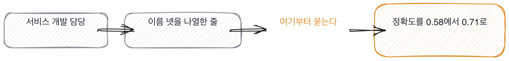
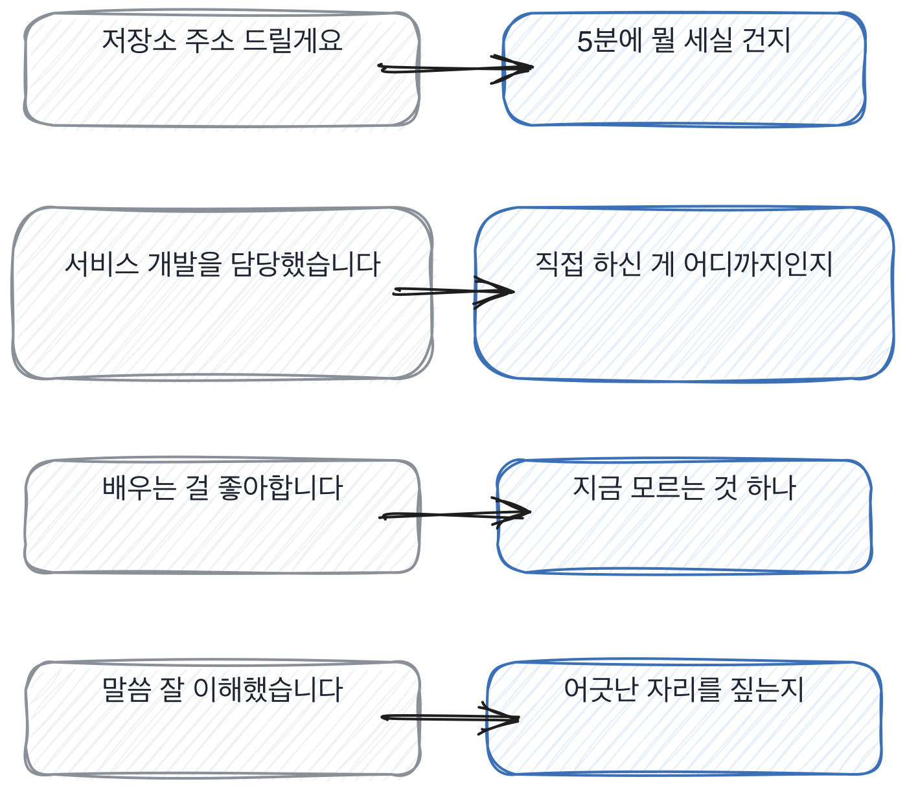

# 16장을 닫으며

## 한 관문을 닫으며

세 칸이 같은 방향으로 갔습니다. **종이에서 판정을 걷어내는 방향**이요.
저장소도 이력서도 점수를 안 매기고 질문만 뽑았습니다. 판정은 그 질문에 답하는 자리로 미뤘고요.
미루면 늦어지는 게 아니라 정확해집니다. 종이는 그 사람이 안 쓴 것일 수 있으니까요.

이 장에서 제일 하고 싶은 말은 마지막 칸에 있습니다. 사람을 보는 자리에서
확인되는 것이 생각보다 적다는 것이요. 45분에 확인되는 건 둘뿐입니다.
모른다고 말하는가, 그리고 어긋난 걸 짚는가. 나머지는 인상입니다.

인상이 나쁘다는 게 아닙니다. 인상은 정확할 때도 있어요. 다만 근거로 쓸 수가 없습니다.
근거로 못 쓰면 디브리프에서 못 꺼내고, 못 꺼내면 목소리 큰 사람 쪽으로 쏠립니다.
**그래서 확인되는 둘만 적고 나머지는 안 적어요.**

이력서 한 장에서 어디를 먼저 보는지도 짚어 둘게요. 위에서 아래가 아니라 아래에서 위로 봅니다.
숫자가 든 줄이 대개 아래쪽에 있거든요.

이력서와 사람 자리에서 자주 들리는 말과 그때 물을 자리를 짝으로 세우면 이렇게 됩니다.

> **저자의 삽질**
>
> 이력서가 너무 매끄럽다는 이유로 안 부르게 되는 자리가 있습니다. 생성된 것 같아서요.
> 그런데 그 사람이 만든 것을 열어 보면 물어봤어야 할 게 거기 있는 경우가 있습니다.
> 글을 잘 쓰는 사람이었던 거죠. 그렇게 되면 글 잘 쓰는 걸 벌한 셈이 됩니다.

생성된 이력서 이야기를 한 번 더 하고 싶습니다. 이게 이 장에서 제일 뜨거운 자리거든요.
걸러야 한다는 말이 계속 나오는데, 저는 그 방향이 이 책 전체와 어긋난다고 봅니다.
**이 책은 준비해 온 사람을 벌하지 않습니다.** 준비로 못 채우는 자리를 물을 뿐이에요.

이력서도 같습니다. 생성됐든 아니든 그 종이에는 준비로 채운 문장이 들어 있고,
그 문장에서 질문을 뽑으면 됩니다. 답하는 자리에서 갈리니까요.
가리려고 애쓰는 대신 물을 자리를 잘 뽑는 데 그 시간을 씁니다.

> **30초 점검**
>
> 저장소를 5분에 볼 때 읽지 말고 셀 것을 하나 정했는가.
> 그 값에서 물을 질문이 하나 나왔는가.
> 이력서 한 줄에서 흐린 동사와 이름 나열을 찾았는가.
> 이력서에 점수를 안 매기고 질문만 뽑았는가.
> 45분 동안 모른다는 말이 한 번이라도 나왔는가.

이 장에서 나온 낱말 몇 개를 짚고 갑니다. 서류와 사람 이야기에 붙는 말들이에요.
채용 절차가 없는 팀에서 오신 분이라면 이 말들이 낯설 텐데, 뜻만 알면 그걸로 충분합니다.

> **채용 말 배우기**
>
> **리크루터 스크린** 채용 담당자가 짧은 통화로 앞에서 거르는 단계를 말합니다.
>
> **레퍼런스 체크** 같이 일한 사람에게 물어보는 절차를 말해요. 사실 확인보다 관점을 얻는 자리입니다.
>
> **포트폴리오** 만든 것을 모아 둔 저장소나 문서를 말합니다. 이력서보다 물을 거리가 많습니다.

옛 관행 하나를 재 봅니다. 이력서로 앞에서 거르던 관행이에요.

> **옛 규칙은 아직 유효한가**
>
> **이력서 스크리닝.** 판정은 이제 안 맞음입니다.
> 근거는 제 경험이에요. 문장의 품질과 사람의 품질이 이제 상관이 없습니다.
> 그래서 저는 이력서로 거르는 대신 **이력서로 질문을 뽑는** 쪽으로 옮겼습니다.
> 거르는 데 쓰던 10분을 질문 뽑는 데 쓰면 면접 45분이 훨씬 나아집니다.

다음 장은 원격과 도구입니다. 지금까지는 앞에 앉은 사람을 봤어요.
같은 방에 있으면 안 물어도 되는 것들이 있었는데, 화면 너머에서는 그게 다 달라집니다.
이제 화면 너머에 있는 사람을 봅니다. 거기서는 무엇을 못 보는지부터 정해야 합니다.

서류와 사람을 볼 때 제가 하는 것을 하나 더 적어 둡니다.
종이를 판정에서 빼고 나면 그 종이로 무엇을 할지가 새로 생기는데, 그게 이런 자잘한 것들입니다.

> **현장에서는**
>
> 저는 이력서를 볼 때 형광펜 대신 물음표를 칩니다. 좋아 보이는 데가 아니라 물을 데에요.
> 반년 해 보니 물음표가 셋 넘게 붙는 이력서가 오히려 면접이 잘 됩니다. 물을 게 많아서요.

속기 쉬운 자리를 하나 더 짚습니다. 이력서가 길면 경력이 많아 보이는 자리요.
이건 저도 오래 걸렸습니다. 줄 수를 세는 습관이 몸에 붙어 있었거든요.

> **여기서 다들 속는다**
>
> 이력서가 길고 항목이 많으면 해 본 게 많아 보입니다. 줄 수가 곧 경력처럼 읽혀요.
> 그런데 줄 수는 쓰는 습관이 정합니다. 같은 일을 한 줄로 쓰는 사람과 다섯 줄로 쓰는 사람이 있어요.
> 그리고 짧게 쓰는 쪽이 대개 더 많이 해 본 사람입니다. 무엇이 중요한지 알아서 줄인 거죠.
> 확인은 줄 수를 무시하면 됩니다. 숫자가 든 줄이 몇인지만 세어 보세요.

저장소를 5분에 본다는 말이 처음에는 좀 이상하게 들립니다. 그 이야기를 하고 닫겠습니다.
제가 이걸 왜 바꿨는지, 바꾸고 나서 무엇이 달라졌는지를 적어 두겠습니다.

> **쉬어 가기**
>
> **쉬어 가기: 저장소를 5분에 본다는 말**
>
> 저장소 주소를 받으면 읽고 싶어집니다. 코드를 읽는 게 우리가 할 줄 아는 일이니까요.
> 그런데 5분에 읽히는 코드는 없습니다. 익숙한 코드도 5분에는 못 읽어요.
>
> 그래서 읽는 대신 세는 건데, 이게 처음에는 좀 이상하게 느껴집니다.
> 코드를 안 읽고 무슨 판단을 하느냐 싶죠. 저도 그랬습니다.
>
> 바뀐 계기가 있었습니다. 어느 날 저장소 셋을 연달아 열어 놓고 5분씩 봤는데,
> 셋 다 읽다가 끝났고 물을 게 하나도 안 정해졌어요. 45분을 썼는데 산출물이 0이었습니다.
> 그다음에 세어 보기로 했습니다. 테스트 파일 수, 단언 개수, 설명 붙은 함수 비율.
>
> 세어 보니 물을 게 바로 나왔습니다. 설명이 없는 함수 아홉 개 중에 하나 골라서
> 왜 그렇게 짰냐고 물으면 되거든요. 그 함수는 그 사람이 짠 거고, 준비된 답도 없습니다.
>
> 여기서 알게 된 게 하나 있습니다. **5분에 할 일은 판단이 아니라 질문 만들기**였어요.
> 판단은 면접에서 하면 됩니다. 5분에는 물을 자리만 정하면 충분합니다.
> 그렇게 자리를 바꾸고 나니 5분이 넉넉해졌습니다.

긴 이야기는 여기까지입니다. 서류와 사람 자리에서 들고 갈 것을 다섯 줄로 접으면 이렇게 됩니다.
종이에서 판정을 걷어내는 게 다섯 줄의 방향이에요.

> **한 관문 요약**
>
> 5분에 읽히는 저장소는 없습니다. 읽지 말고 세라고 하면 그 자리에서 갈립니다.
>
> 이력서는 판정하는 물건이 아니라 질문을 뽑는 재료입니다. 자리를 바꾸면 생성 여부가 안 중요해집니다.
>
> 숫자가 이미 든 줄은 물을 게 없습니다. 그게 잘 쓴 한 줄이에요.
>
> 45분에 확인되는 건 둘뿐입니다. 모른다고 말하는가, 어긋난 걸 짚는가.
>
> 나머지는 인상입니다. 인상은 근거로 못 쓰니 기록에 안 적습니다.
>
> 다음 관문에서 뒤집히는 것. 앞에 앉은 사람을 보던 자리에서 화면 너머를 보는 자리로 넘어갑니다.

> **이 판정이 헐거운 지점**
>
> 저장소가 없는 사람이 이 장의 첫 칸에서 불리합니다. 회사 코드는 못 보여주니까요.
>
> 모른다고 말하는 습관은 앞선 팀 분위기에서 오기도 합니다. 그 사람 것만은 아니에요.
>
> 어긋난 걸 일부러 만들어 보는 방식은 지원자를 속이는 면이 있습니다. 저는 끝나고 밝힙니다.
