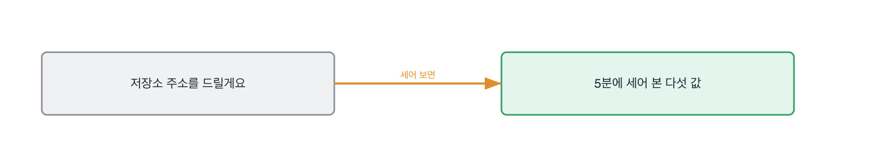

# 16.1 이력서에서 물을 자리를 뽑는 순서

*[15.4](../15-g15/q052.md) 까지가 만든 것을 본 이야기였죠. 이번엔 그 사람이 내민 종이와 주소를 봅니다.*

> **이 말부터**
>
> **훑기** 읽지 않고 세는 것을 말합니다. 5분에 할 수 있는 건 세는 것뿐이에요.
>
> **단언** 테스트가 무엇을 못 박고 있는지를 말합니다. 테스트 개수와는 다른 숫자입니다.

이 장부터 렌즈가 사람으로 바뀝니다. 그런데 첫 칸은 사람이 아니라 종이와 주소를 봐요.
사람을 보기 전에 무엇을 물을지부터 정해야 하거든요. 그게 이 칸의 일입니다.
**이력서와 저장소는 판정하는 물건이 아니라 질문을 뽑는 재료입니다.**

저장소 주소를 받으면 대개 읽으려고 합니다. 그런데 5분에 읽히는 코드는 없어요.
5분에 할 수 있는 건 세는 겁니다. 그리고 세는 것만으로도 물을 자리가 나옵니다.
무엇을 셀지가 이 칸의 전부예요.

이 책의 과제 꾸러미 하나를 훑는 코드가 이렇게 생겼습니다.

```python
def look(target: Path = TARGET) -> RepoView:
    code = tests = lines = asserts = documented = undocumented = defects = 0
    for path in python_files(target):
        text = path.read_text(encoding="utf-8")
        tree = ast.parse(text)
        is_test = path.name.startswith("test_")
        if is_test:
            tests += 1
            asserts += sum(1 for n in ast.walk(tree) if isinstance(n, ast.Assert))
        else:
            code += 1
            lines += len(text.splitlines())
            for func in _functions(tree):
                if ast.get_docstring(func):
                    documented += 1
                else:
                    undocumented += 1
        if "일부러" in text:
            defects += 1
    return RepoView(code, tests, lines, asserts, documented, undocumented, defects)
```

세는 건 다섯입니다. 코드 파일 수, 테스트 파일 수, 단언 개수, 설명이 붙은 함수 비율,
그리고 일부러 남겼다고 적어 둔 파일이요. 열여덟 줄이면 다 세집니다.
**훑는 대상을 꾸러미 하나로 먼저 좁힌 것도 이 절차의 한 줄입니다.** 저장소 전체는 5분에 못 셉니다.

돌려 보면 이렇게 나옵니다.

돌려 보면 이렇게 나옵니다. 과제 꾸러미를 훑고 이력서에서 질문을 뽑았습니다

```
코드 파일 4  테스트 파일 3  코드 줄 216
단언 21개, 테스트 파일당 7.0
설명이 붙은 함수 5/14 (0.357)
일부러 남겼다고 적어 둔 파일 1

이력서에서 뽑은 질문
  사내 문서 검색 서비스 개발 담당
    - 그게 얼마나였는지 숫자로 하나만 말씀해 주시겠어요
    - 그중에 직접 하신 건 어디까지예요
  Python, 웹 프레임워크, 관계형 DB, 캐시 활용
    - 그게 얼마나였는지 숫자로 하나만 말씀해 주시겠어요
    - 이 중에 직접 고치신 게 있는 건 어느 거예요
  검색 정확도를 0.58에서 0.71로 개선
    - 물을 것 없음
  검색 파이프라인 구축 및 성능 최적화 수행
    - 그게 얼마나였는지 숫자로 하나만 말씀해 주시겠어요
    - 그중에 직접 하신 건 어디까지예요
```

코드 넷에 테스트 셋, 단언 스물하나. 파일당 일곱이에요.
설명이 붙은 함수는 열넷 중 다섯이에요. 절반이 안 됩니다.
여기까지가 5분이고, 여기까지만 있어도 물을 게 정해집니다.



설명 없는 함수 아홉 개 중 하나를 골라서 왜 그렇게 짰냐고 물으면 됩니다.
그 함수는 지원자가 짠 것이고, 설명이 없으니 준비된 답도 없어요.
[12.2](../12-g12/q040.md) 에서 깨지는 입력을 물었던 것과 같은 모양입니다. 실물에 대고 묻는 거죠.

> **이렇게 답합니다**
>
> 먼저 README를 읽고 프로젝트의 전체적인 목적을 파악하겠습니다.
> 그다음 디렉터리 구조를 살펴보며 아키텍처를 이해하겠습니다.
> 핵심 모듈의 코드를 읽으며 구현 수준을 확인하겠습니다.
> 커밋 히스토리를 통해 개발 과정도 함께 보겠습니다.

네 줄이 다 맞는 순서입니다. 그리고 네 줄을 다 하면 5분이 훨씬 넘습니다.

> **표시해 보면**
>
> 먼저 README를 읽고 프로젝트의 전체적인 목적을 파악하겠습니다.
>     ← 저장소마다 다 하는 첫 줄. 5분에 무엇을 얻는지 없음
> 그다음 디렉터리 구조를 살펴보며 아키텍처를 이해하겠습니다.
>     ← 이해하겠다는 말. 5분에 이해되는 구조는 없음
> 핵심 모듈의 코드를 읽으며 구현 수준을 확인하겠습니다.
>     ← 핵심이 어느 파일인지 정하는 방법이 없음
> 커밋 히스토리를 통해 개발 과정도 함께 보겠습니다.
>     ← 넷째까지 왔는데 5분이 이미 지났음

첫 줄과 둘째 줄에 이해하겠다는 말이 나옵니다. 5분에 이해되는 구조는 없어요.
셋째 줄의 핵심 모듈이 어느 파일인지 정하는 방법이 없고요.
**넷째 줄까지 오면 5분이 이미 지났습니다.** 순서를 댔는데 시간 안에 안 끝나는 순서입니다.

> **이렇게 파고듭니다**
>
> 물음: 5분이면 넷 중 하나만 되실 텐데, 어느 하나를 고르시겠어요?
>
> 답: 상황에 따라 우선순위를 조정하겠습니다.

상황에 따라 조정하겠다는 답이 나오면 거기서 정해집니다. 안 골라 본 겁니다.
5분을 실제로 써 본 사람은 하나를 고릅니다. 넷 다 못 한다는 걸 아니까요.

> **훑어 본 사람이면**
>
> 읽지는 않고 세기만 할게요. 테스트 파일이 몇 개고 단언이 몇 갠지요.
> 여기는 코드 넷에 테스트 셋이고 단언이 스물하나네요. 파일당 일곱이요.
> 그리고 함수에 설명이 붙었는지 봅니다. 열넷 중 다섯이니까 절반이 안 됩니다.
> 그럼 물을 게 정해져요. 설명이 없는 아홉 중에 왜 그렇게 짰는지 하나 물어보면 됩니다.

첫 줄이 이 답의 문장입니다. 읽지 않고 세기만 하겠다고 하죠.
둘째 줄과 셋째 줄에 값이 나오고요. 넷에 셋, 스물하나, 열넷 중 다섯.
**넷째 줄이 그 값을 질문으로 바꾼 자리입니다.** 세는 것으로 끝나지 않고 물을 데까지 갔어요.

> **현장에서는**
>
> 저는 저장소를 볼 때 타이머를 켭니다. 5분에 알람이 울리면 그 자리에서 멈춰요.
> 멈추고 나서 물을 게 하나도 안 정해져 있으면, 그건 제가 읽고 있었다는 뜻입니다.

5분 훑기 이야기는 여기까지입니다. 무엇을 셀지 하나 고르고, 그 값에서 질문 하나가 나오면 됩니다.
읽겠다고 하면 그때 다시 물어보세요.

> **판정**
>
> 5분 안에 셀 수 있는 것 하나를 고르고, 그 값에서 물을 질문을 하나 만들면 통과입니다.
> 읽지 않고 세겠다고 먼저 말하면 아주 좋은 신호예요.
>
> 읽는 순서를 넷 늘어놓고, 하나만 고르라고 해도 상황에 따라 조정하겠다고 답하면
> 다음 라운드로 안 보냅니다. 실제 저장소를 줬는데 값을 하나도 못 대도 같습니다.
>
> 기록에는 이렇게 적습니다. 읽지 않고 세겠다고 먼저 밝혔고, 테스트 셋에 단언 스물하나와
> 설명 붙은 함수 열넷 중 다섯을 값으로 댔으며, 설명 없는 함수 하나를 물을 자리로 골랐다.

> **물을 문장 둘**
>
> 저장소를 주면 읽으려고 합니다. 읽는 데는 5분이 안 됩니다. 그래서 하나만 고르라고 합니다.
> 하나를 고르면 왜 그걸 먼저 세는지가 따라 나오고, 그 이유가 실제로 훑어 본 사람의 표시입니다.
>
> **그대로 읽으세요.** *5분이면 하나밖에 못 하실 텐데, 뭘 먼저 보시겠어요?*
>
> **답을 받으면 이어서.** *거기서 무슨 값이 나오면 뭘 물어보실 거예요?*

> **이걸 놓치면**
>
> 훑는 순서를 못 받으면 [16.2](q054.md) 에서 이력서를 줘도 어느 줄을 골라야 할지 못 정합니다.

