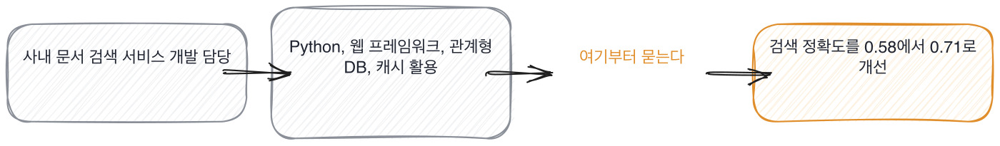

# 16.2 생성된 이력서와 만든 이력서

*[16.1](q053.md) 에서 저장소를 훑었죠. 이번엔 그 옆에 놓인 종이를 봅니다.*

> **이 말부터**
>
> **흐린 동사** 담당, 참여, 기여처럼 누가 했는지가 안 보이는 동사를 말합니다.
>
> **질문지** 이력서 한 줄에서 뽑아낸 물어볼 문장을 말해요. 점수가 아니라 문장입니다.

이력서가 생성된 것 같다는 말이 요즘 자주 나옵니다. 문장이 매끄럽고 줄 길이가 고르거든요.
그래서 걸러야 한다는 이야기로 이어지는데, 저는 그 방향이 틀렸다고 봅니다.
**생성된 이력서를 탈락 사유로 삼지 않습니다.** 이유는 셋입니다.

첫째, 못 가릅니다. 잘 쓴 사람과 잘 만든 도구를 문장으로 구분할 방법이 지금 없어요.
둘째, 가려도 얻는 게 없습니다. 이력서 문장의 품질과 일하는 능력은 원래도 상관이 약했습니다.
셋째, 이력서는 애초에 판정하는 물건이 아닙니다. 무엇을 물을지 정하는 재료예요.

세 번째가 이 칸의 자리입니다. 이력서를 판정에서 빼고 질문 뽑는 데로 옮기면
생성됐는지 아닌지가 안 중요해집니다. **어느 쪽이든 질문은 똑같이 나오거든요.**
그리고 질문에 답하는 자리에서는 만든 사람과 안 만든 사람이 갈립니다.

이력서 한 줄에서 질문을 뽑는 규칙이 이렇게 생겼습니다.

```python
def questions_for(line: str) -> list[str]:
    """한 줄에서 나오는 질문들. 없으면 빈 목록이고, 그건 물을 게 없다는 뜻이다."""
    asks = []
    if not NUMBER.search(line):
        asks.append("그게 얼마나였는지 숫자로 하나만 말씀해 주시겠어요")
    if VAGUE_VERB.search(line):
        asks.append("그중에 직접 하신 건 어디까지예요")
    if LISTY.search(line):
        asks.append("이 중에 직접 고치신 게 있는 건 어느 거예요")
    return asks
```

숫자가 없으면 숫자를 묻고, 흐린 동사가 있으면 어디까지 했는지 묻고,
이름이 나열돼 있으면 그중 어느 걸 직접 고쳤는지 묻습니다. 셋뿐이에요.
그리고 나오는 것은 점수가 아니라 물어볼 문장입니다.



[16.1](q053.md) 에서 돌린 그 출력의 뒷부분이 이 질문지입니다. 네 줄에서 여섯 개가 나왔어요.
그런데 한 줄만 질문이 하나도 안 나왔습니다. 숫자가 둘 든 줄이요.
**그 줄은 이력서가 이미 답을 하고 있어서 물을 게 없습니다.** 그게 잘 쓴 한 줄입니다.

> **이렇게 옵니다**
>
> 사내 문서 검색 서비스 개발 담당
> Python, 웹 프레임워크, 관계형 DB, 캐시 활용
> 검색 파이프라인 구축 및 성능 최적화 수행
> 데이터 기반 의사결정을 통한 지속적 품질 개선

네 줄 중 셋째까지는 물을 게 있고, 넷째 줄은 아무것도 안 말합니다.

> **표시해 보면**
>
> 사내 문서 검색 서비스 개발 담당
>     ← 담당이 어디까지인지 없음. 숫자 없음
> Python, 웹 프레임워크, 관계형 DB, 캐시 활용
>     ← 이름 나열. 어디까지 만졌는지 없음
> 검색 파이프라인 구축 및 성능 최적화 수행
>     ← 구축과 최적화 둘 다 크기 없음
> 데이터 기반 의사결정을 통한 지속적 품질 개선
>     ← 네 줄 중 유일하게 아무것도 안 말하는 줄

첫 줄의 담당이 어디까지인지 없고, 둘째 줄은 이름 나열입니다.
셋째 줄은 구축과 최적화가 둘 다 크기 없이 붙어 있고요.
**넷째 줄은 네 줄 중 유일하게 아무 정보가 없는 줄입니다.** 그런데 제일 잘 쓰인 문장처럼 읽혀요.

> **이렇게 파고듭니다**
>
> 물음: 셋째 줄의 최적화에서 어느 숫자가 얼마나 움직였어요?
>
> 답: 전반적으로 응답 속도와 정확도가 개선되었습니다.

전반적으로 개선됐다는 답은 [13.1](../13-g13/q043.md) 에서 본 그 자리입니다. 앞 숫자가 없어요.
이력서 한 줄을 골라 물었을 뿐인데 평가 이야기로 이어집니다. 이게 이력서를 재료로 쓴다는 뜻이에요.

> **만든 사람이면**
>
> 셋째 줄은 사실 제가 한 게 아니라 팀이 한 거예요. 저는 평가 쪽만 했습니다.
> 그래서 이력서에는 저렇게 적었는데, 물어보시면 이렇게 말씀드려야죠.
> 제가 한 건 정답 목록 만든 거랑 0.58을 0.71로 올린 겁니다.
> 파이프라인 구축은 옆자리 분이 했어요.

첫 줄이 이 답을 다른 답과 갈라 놓습니다. 셋째 줄은 자기가 한 게 아니라고 하죠.
**자기 이력서를 스스로 깎는 문장이에요.** 이건 준비된 답에서 잘 안 나옵니다.
매끄럽게 쓰는 쪽으로 준비하지 자기 몫을 줄이는 쪽으로는 준비 안 하거든요.

셋째 줄과 넷째 줄에서 경계가 그어집니다. 정답 목록과 0.58에서 0.71까지는 자기 것이고,
파이프라인 구축은 옆자리 분 것이라고요. [7.4](../07-g07/q026.md) 에서 남의 일과 내 일을 가르던 손입니다.
이 사람의 이력서가 생성됐는지는 여기까지 와도 모릅니다. 그리고 이제 안 궁금해요.

> **여기서 다들 속는다**
>
> 매끄러운 이력서를 보면 잘 쓴 사람이라고 느껴집니다. 문장이 고르고 낱말이 정확하니까요.
> 그런데 이력서의 문장 품질은 그 사람이 아니라 그 문장을 만든 쪽의 품질입니다.
> 둘이 같을 수도 있고 아닐 수도 있는데, 종이만 봐서는 갈릴 방법이 없어요.
> 그래서 이력서에서는 판정하지 않고 질문만 뽑습니다. 판정은 그 질문에 답하는 자리에서 합니다.

이력서 이야기는 여기까지입니다. 한 줄을 골라 물었을 때 스스로 좁히느냐만 봅니다.
생성됐는지 아닌지는 여기까지 와도 모르고, 이제 안 궁금합니다.

> **판정**
>
> 자기 이력서 한 줄을 스스로 좁히거나 남의 몫을 갈라 말하면 통과입니다.
> 숫자가 이미 든 줄을 가리키며 그건 자기가 잰 것이라고 말하면 아주 좋은 신호예요.
>
> 이력서에 적힌 문장을 말로 그대로 반복하고, 한 줄을 골라 물어도 전반적으로 개선됐다는 식으로
> 답하면 다음 라운드로 안 보냅니다. 다만 이력서가 생성된 것 같다는 이유로는 안 보냅니다.
>
> 기록에는 이렇게 적습니다. 이력서 셋째 줄이 팀의 일이고 자기 몫은 평가 쪽이었다고 스스로
> 좁혔으며, 자기가 한 것으로 정답 목록과 0.58에서 0.71까지를 댔다.

> **물을 문장 둘**
>
> 이력서를 보면 판정하고 싶어집니다. 그런데 종이는 판정할 물건이 아니에요. 그래서 한 줄만 고릅니다.
> 한 줄을 고르면 그 줄의 크기와 자기 몫이 따라 나오고, 그게 만든 사람과 받은 사람을 가릅니다.
>
> **그대로 읽으세요.** *이 중에 한 줄만 골라서 여쭤볼게요. 여기서 직접 하신 건 어디까지예요?*
>
> **답을 받으면 이어서.** *그 줄에 숫자를 하나 넣는다면 뭘 넣으시겠어요?*

> **이걸 놓치면**
>
> 질문을 못 뽑으면 [16.3](q055.md) 에서 사람을 볼 때 확인할 자리 없이 인상만 남습니다.

