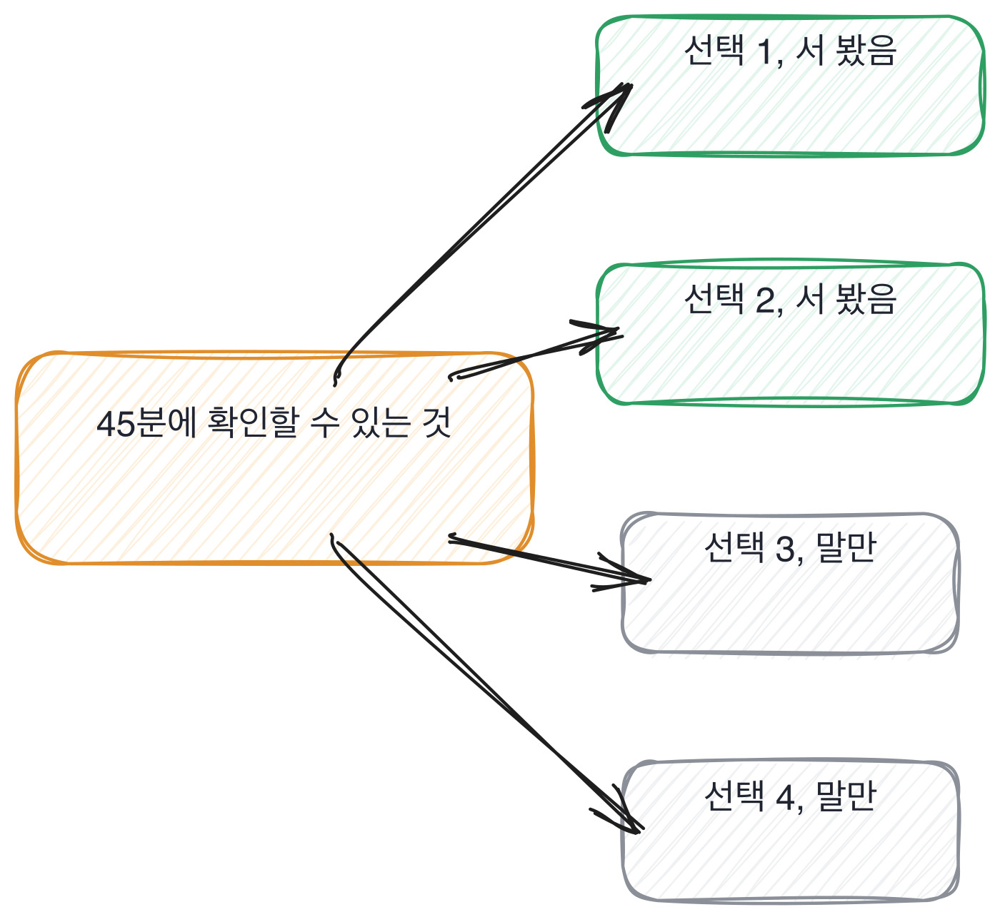

# 16.3 같이 일할 수 있는가

*[16.2](q054.md) 에서 질문을 뽑았죠. 이번엔 그 질문에 답하는 사람을 봅니다.*

> **이 말부터**
>
> **모르는 자리** 지금 이 사람이 설명 못 하는 것 하나를 말합니다. 없는 사람은 없어요.
>
> **되짚기** 상대 말이 어긋났을 때 그 자리를 짚고 다시 묻는 것을 말합니다.

같이 일할 수 있느냐는 질문은 위험합니다. 답이 인상으로 나오거든요.
그리고 인상은 첫 3분에 정해지고 나머지 42분 동안 근거를 모읍니다. 반대가 아니라요.
**그래서 이 칸은 성격을 안 봅니다.** 확인할 수 있는 두 가지만 봅니다.

첫째는 모른다고 말하는가입니다. 45분 동안 모른다는 말이 한 번도 안 나오면 그게 신호예요.
아는 게 많아서가 아니라, 모르는 자리를 말하는 습관이 없다는 뜻입니다.
그 습관이 없으면 들어와서 막혔을 때도 안 말합니다. 그게 팀에서 제일 비싼 자리예요.

둘째는 어긋난 걸 짚는가입니다. 이건 제가 만들어서 확인합니다.
설명하다가 순서를 일부러 어긋나게 말해요. 아까 캐시를 먼저 비운다고 했다가 나중에 비운다고 하는 식으로요.
**짚는 사람과 넘어가는 사람이 그 자리에서 갈립니다.**

이 둘을 고른 이유는 하나입니다. 다른 것들은 45분에 확인이 안 돼요.
협업을 잘하는지, 갈등을 어떻게 푸는지, 압박에서 어떤지. 다 중요한데 이 방에서는 안 보입니다.
안 보이는 걸 본 척하면 그게 인상이 됩니다. 그래서 확인되는 둘만 씁니다.

> **이렇게 답합니다**
>
> 새로운 기술을 배우는 것을 좋아해서 늘 학습하고 있습니다.
> 모르는 부분이 있으면 적극적으로 찾아보고 동료들과 공유합니다.
> 빠르게 성장하는 환경에서 함께 일하고 싶습니다.

세 줄이 다 좋은 태도입니다. 그리고 세 줄에 모르는 것이 하나도 안 나옵니다.

> **표시해 보면**
>
> 새로운 기술을 배우는 것을 좋아해서 늘 학습하고 있습니다.
>     ← 태도. 지금 모르는 것이 무엇인지 없음
> 모르는 부분이 있으면 적극적으로 찾아보고 동료들과 공유합니다.
>     ← 절차 서술. 실제로 모르는 것이 하나도 안 나옴
> 빠르게 성장하는 환경에서 함께 일하고 싶습니다.
>     ← 질문에 대한 답이 아님

첫 줄은 배우는 걸 좋아한다는 태도고, 둘째 줄은 모르면 찾아본다는 절차입니다.
**둘 다 지금 모르는 것이 무엇인지는 안 말해요.** 질문은 그걸 물었는데요.
셋째 줄은 아예 다른 이야기로 갑니다. [1.3](../01-g01/q003.md) 에서 본 비껴가기입니다.

> **이렇게 파고듭니다**
>
> 물음: 그럼 지금 이 순간에 잘 모르겠는 걸 하나만요.
>
> 답: 아직 부족한 부분이 많다고 생각합니다.

부족한 부분이 많다는 답은 겸손해 보이지만 아무것도 안 말합니다.
하나만 대라고 했는데 여전히 하나가 안 나왔어요. 여기서 한 번 더 안 물어봅니다.
두 번 물어서 안 나오면 그건 준비가 아니라 습관입니다.

> **모른다고 말하면**
>
> 임베딩을 왜 그 모델로 정했는지 저는 아직 모릅니다. 제가 정한 게 아니어서요.
> 바꿔 보긴 했는데 나빠져서 되돌렸고, 왜 나빠졌는지는 설명 못 하겠어요.
> 차원 수 때문인 것 같은데 확인은 안 해 봤습니다.
> 그건 지금도 숙제로 남아 있습니다.

첫 줄에 자리가 하나 나옵니다. 임베딩 모델을 왜 그걸로 정했는지 모른다고 하죠.
둘째 줄이 더 좋아요. 바꿔 봤는데 나빠졌고, 왜 나빠졌는지는 설명 못 하겠다고 합니다.
**해 본 것과 모르는 것이 한 문장에 같이 있습니다.** 이게 진짜 모르는 자리의 모양이에요.

셋째 줄에 짐작이 있고 확인은 안 했다고 덧붙입니다. 짐작과 확인을 가른 겁니다.
[2.4](../02-g02/q009.md) 에서 해 본 것과 읽은 것을 갈랐던 그 손이 여기서는 아는 것과 짐작을 가릅니다.
그리고 넷째 줄에서 지금도 숙제라고 닫아요. 안 끝난 것을 안 끝났다고 말하는 문장입니다.

> **한 번 더**
>
> 어긋난 걸 짚는지는 제가 만들어서 봅니다. 순서를 일부러 바꿔 말해 보는 거예요.
> 아닙니다, 말씀하신 내용 잘 이해했습니다.
> 잘 이해했다고 답하면 거기서 정해집니다. 이해할 수 없게 말했거든요.
> 반대쪽은 헷갈렸다고 말하고 어느 쪽이냐고 되묻습니다. 그리고 답을 듣고 나서 이해했다고 합니다.

되묻는 게 왜 중요하냐면, 안 되묻는 사람은 들어와서도 안 되묻기 때문입니다.
설명이 어긋난 걸 알면서도 넘어가는 건 그 자리에서는 편하고 두 주 뒤에 비싸요.
**그리고 이건 성격이 아니라 습관이라 45분에 보입니다.**

한 가지 조심할 게 있습니다. 되묻지 않았다고 바로 안 보내면 안 돼요.
긴장해서 못 짚는 사람이 섞여 있고, 저는 그 둘을 못 가릅니다.
그래서 저는 두 번 만들어 보고, 두 번 다 안 짚으면 그때 적습니다.

> **판정**
>
> 지금 모르는 것 하나를 자리로 대고, 짐작과 확인을 갈라 말하면 통과입니다.
> 제가 어긋나게 말한 자리를 짚고 되물으면 아주 좋은 신호예요.
>
> 배우는 걸 좋아한다거나 부족한 점이 많다고만 하고, 하나만 대라고 두 번 물어도
> 자리를 못 대면 다음 라운드로 안 보냅니다. 성격이나 인상은 기록에 안 적습니다.
>
> 기록에는 이렇게 적습니다. 임베딩 모델을 왜 그걸로 정했는지 모른다고 자리로 댔고,
> 바꿨다가 나빠진 이유는 설명 못 하겠다며 짐작과 확인을 갈랐으며, 어긋난 순서를 한 번 짚었다.

> **물을 문장 둘**
>
> 같이 일할 수 있냐는 건 물어서 알 수 없습니다. 그래서 모르는 자리를 하나 달라고 합니다.
> 자리를 대면 짐작과 확인이 갈리고, 그 가르는 습관이 팀에서 그대로 나옵니다.
>
> **그대로 읽으세요.** *지금 하시는 일 중에 아직 잘 모르겠는 게 뭐예요?*
>
> **답을 받으면 이어서.** *그건 짐작이세요, 확인해 보신 거예요?*

> **이걸 놓치면**
>
> 모르는 자리를 못 받으면 [18.1](../18-g18/q059.md) 에서 신뢰 등급을 매길 때 붙여 줄 양을 못 정합니다.

