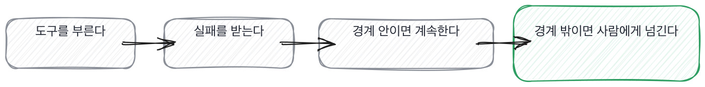
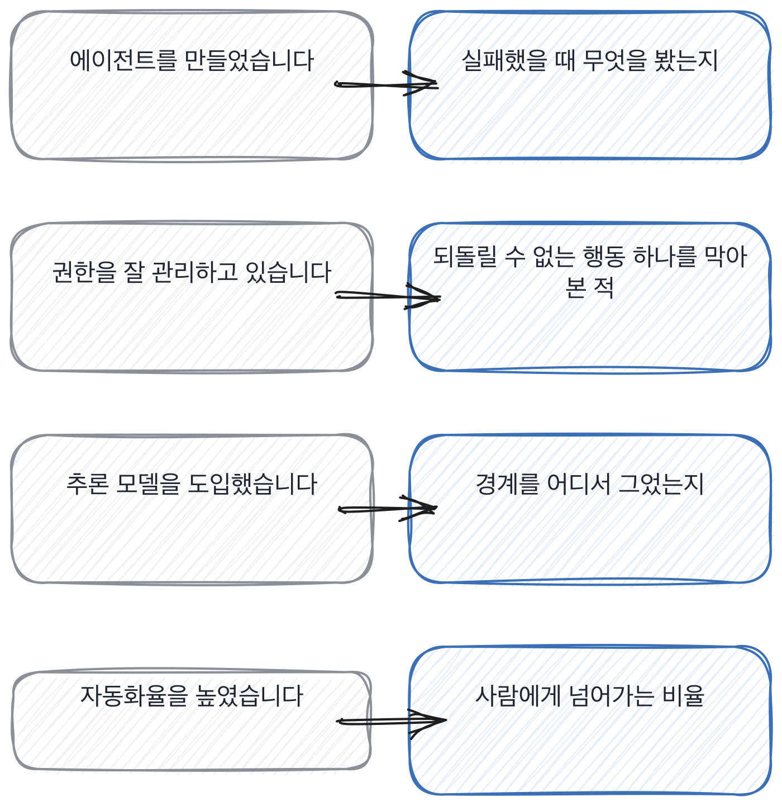

# 17장을 닫으며

## 한 관문을 닫으며

세 칸이 같은 자리로 모입니다. **에이전트를 썼다는 말이 아니라 그게 혼자 움직이다 틀렸을
때 무엇을 했는지를 보는 자리**요. 실패를 처리한 코드, 생각 시간을 끊은 기준, 되돌릴 수 없는
행동을 막은 경계. 셋 다 같은 것을 다른 각도로 묻습니다. 이 일을 실제로 돌려 본 적이 있는가.

도구를 묶어 쓰는 일은 이제 특별한 경력이 아닙니다. 그래서 묶어 썼냐고 물으면 거의 다
썼다고 답해요. 가르는 건 그 경험의 유무가 아니라 밀도입니다. 실패를 몇 번 봤고, 그중
몇 번을 고쳤고, 고친 다음 숫자가 어떻게 움직였는지.

에이전트 자리에서 자주 들리는 말과 그때 물을 자리를 짝으로 세우면 이렇게 됩니다.

> **저자의 삽질**
>
> 저는 한 번 에이전트가 스스로 보고한 성공을 그대로 믿은 적이 있습니다.
> 로그를 열어 보니 절반은 빈 결과를 성공으로 센 것이었어요.

에이전트가 스스로 보고하는 상태와 실제로 일어난 일은 다른 물건입니다. 이 둘을 같은
것으로 섞으면 자동화율 같은 숫자가 실제보다 좋게 나와요. 그래서 다음 칸으로 넘어가기
전에 이 자리를 짚고 갑니다. 숫자는 누가 센 것인가.

> **30초 점검**
>
> 도구 호출이 실패한 사례를 구체적으로 말하는가.
> 그 실패가 몇 번째에서 사람에게 넘어가는지 숫자가 있는가.
> 추론 시간을 끊은 기준이 있고, 그 기준을 바꿔 본 적이 있는가.
> 되돌릴 수 없는 행동 하나를 짚어서 막아 본 경험이 있는가.
> 자동화율을 말할 때 그 숫자를 누가 어떻게 셌는지 아는가.

이 장에서 나온 낱말 몇 개를 짚고 갑니다. 에이전트를 운영하는 자리에 붙는 말들이에요.

> **채용 말 배우기**
>
> **에이전트 루프** 에이전트가 생각하고 도구를 부르고 결과를 받아 다시 생각하는 한 바퀴를 말합니다. 이 바퀴가 몇 번 도는지가 비용과 직결됩니다.
>
> **휴먼인더루프** 에이전트가 끝내기 전에 사람이 한 번 확인하고 넘기는 자리를 말해요. 되돌릴 수 없는 행동 앞에 둡니다.
>
> **폴백** 자동 처리가 실패했을 때 넘어가는 대체 경로를 말합니다. 폴백이 없으면 실패가 그대로 사용자에게 갑니다.

옛 관행 하나를 재 봅니다. 자동화율을 숫자로 요구하던 관행이에요.

> **옛 규칙은 아직 유효한가**
>
> **자동화율을 핵심 지표로 삼는 관행.** 판정은 조정해서 유효입니다.
> 근거는 제 경험이에요. 자동화율만 보면 에이전트가 쉬운 것만 골라 받는 구간이 생깁니다.
> 그래서 저는 자동화율과 함께 **사람에게 넘어간 사례의 난이도**를 같이 봅니다.
> 쉬운 것만 자동화하고 어려운 건 전부 사람에게 넘기면 자동화율은 높아도 남는 일은 그대로예요.

다음 장이 마지막입니다. 지금까지는 한 사람을 어떻게 볼지, 그리고 그 사람이 다루는
에이전트를 어떻게 볼지를 다뤘어요. 이제 그 판단을 팀이 같이 쓰는 물건으로 만듭니다.
그게 이 책이 끝나는 자리입니다.

에이전트 자리에서 제가 실제로 하는 것을 하나 더 적어 둘게요.

> **현장에서는**
>
> 저는 에이전트에게 맡긴 일의 목록을 따로 적어 둡니다. 그리고 그 옆에 사람이 확인하는
> 비율도 같이 적어요. 지난 분기엔 그 비율이 40퍼센트였습니다. 줄이는 게 목표가 아니라
> 어디서 줄여도 되는지를 보는 목록이에요.

이 관문에서 속기 쉬운 자리를 하나 짚습니다. 자동화율이 높으면 잘하고 있는 것처럼 보이는데,
그 숫자 혼자서는 아무것도 증명하지 못합니다. 누가 무엇을 골랐는지를 같이 봐야
비로소 쓸 만한 숫자가 됩니다.

> **여기서 다들 속는다**
>
> 자동화율이 높으면 잘하고 있는 것처럼 느껴집니다. 숫자가 올라가니까요.
> 그런데 그 숫자는 거짓말을 하기 쉽습니다. 쉬운 요청만 에이전트가 받고 어려운 건
> 전부 사람에게 넘기면, 자동화율은 높아도 에이전트가 한 일의 값은 작습니다.
> 확인은 사람에게 넘어간 사례가 어떤 난이도였는지 물으면 됩니다.

속기 쉬운 자리가 하나 더 있습니다. 에이전트가 스스로 성공했다고 보고하면 그 말을 그대로
믿어도 될 것 같지만, 보고와 실제로 일어난 일은 다른 물건입니다.

> **여기서 다들 속는다**
>
> 에이전트가 성공했다는 상태를 돌려주면 실제로 성공한 것 같습니다. 모델이 그렇게
> 말하니까요. 그런데 모델은 자기가 부른 도구의 결과를 잘못 읽고도 성공했다고 말할 수
> 있습니다. 빈 결과를 성공으로 세는 게 흔한 예예요. 확인은 성공을 어떻게 검증했는지,
> 그 검증을 사람이 했는지 다른 도구가 했는지 물으면 됩니다.

자동화율 이야기를 이 장에서 여러 번 꺼냈는데, 왜 그 숫자를 의심해야 하는지는 아직
안 풀었어요. 느낌으로 넘기지 않고 구조를 짚어 두고 이 장을 닫을게요.

> **쉬어 가기**
>
> **쉬어 가기: 왜 자동화율은 거짓말을 하기 쉬운가**
>
> 자동화율이 거짓말을 하기 쉬운 숫자라고 이 장에서 여러 번 말했는데, 왜 그런지를
> 한 번 적어 두겠습니다. 느낌이 아니라 구조가 그렇게 생겼습니다.
>
> 첫째, 고르는 쪽이 에이전트입니다. 사람이 일을 골고루 나눠 주는 게 아니라, 에이전트가
> 자신 있는 것만 먼저 처리하고 애매한 건 넘깁니다. 그러니 에이전트가 처리한 것들만
> 모아 비율을 내면 당연히 쉬운 쪽에 쏠립니다.
>
> 둘째, 넘긴 것의 난이도가 안 보입니다. 자동화율 90퍼센트와 60퍼센트 중 어느 쪽이
> 더 나은지는 넘긴 10퍼센트와 40퍼센트의 난이도를 모르면 비교가 안 됩니다. 쉬운 일
> 10퍼센트를 넘긴 쪽이 어려운 일 40퍼센트를 넘긴 쪽보다 오히려 못할 수 있어요.
>
> 셋째, 실패와 성공의 경계가 에이전트 스스로 매겨집니다. 사람이 채점하는 게 아니라
> 에이전트가 자기 결과를 성공이라고 표시하면 그대로 집계됩니다. 그 표시가 틀리면
> 숫자 전체가 틀립니다.
>
> 셋을 놓고 보면 결론이 하나로 모입니다. 자동화율 하나만 보고받으면 속습니다.
> 그래서 이 책은 자동화율 옆에 꼭 다른 숫자를 하나 더 둡니다. 사람에게 넘어간
> 사례의 난이도, 그리고 그 성공 표시를 누가 검증했는지요.

긴 이야기는 여기까지입니다. 에이전트 자리에서 들고 갈 것을 다섯 줄로 접으면 이렇게 됩니다.
혼자 틀렸을 때 무엇을 봤는지를 물으라는 게 다섯 줄의 요지예요. 낱말이 아니라 숫자와
사고의 기록을 들고 가시면 됩니다.

> **한 관문 요약**
>
> 에이전트를 만들었다는 말만으로는 안 가립니다. 도구 호출이 실패했을 때 무엇을 봤는지로
> 가릅니다.
>
> 추론 모델을 썼다는 말도 마찬가지입니다. 짧게 끝낼 자리와 더 끌고 갈 자리를 가른 기준이
> 있어야 해 본 사람입니다.
>
> 되돌릴 수 없는 행동 하나를 짚어서 막아 본 경험이 권한 관리의 증거입니다. 낱말로는 안
> 갈립니다.
>
> 자동화율은 혼자 보면 속습니다. 사람에게 넘어간 사례의 난이도를 같이 물으세요.
>
> 에이전트가 스스로 보고하는 성공과 실제 성공은 다른 물건입니다. 검증을 누가 했는지
> 물으세요.
>
> 다음 관문에서 뒤집히는 것. 한 사람을 보던 자리에서 팀이 같이 쓰는 물건을 만드는
> 자리로 넘어갑니다.

> **이 판정이 헐거운 지점**
>
> 되돌릴 수 없는 행동의 경계는 회사 규모와 보상 정책에 따라 다릅니다. 3만 원이라는
> 숫자는 한 사례일 뿐 기준값이 아닙니다.
>
> 생각 시간을 끊는 기준을 숫자로 답하지 못해도 실제로 운영해 본 사람일 수 있습니다.
> 이 장이 숫자를 요구하는 건 재 본 적이 있는지를 보려는 것이지 숫자 자체가 목적이
> 아닙니다.
>
> 에이전트 평가는 이 책이 다루는 것보다 훨씬 넓은 분야입니다. 여기서는 면접 45분 안에
> 확인할 수 있는 자리만 다뤘습니다.
