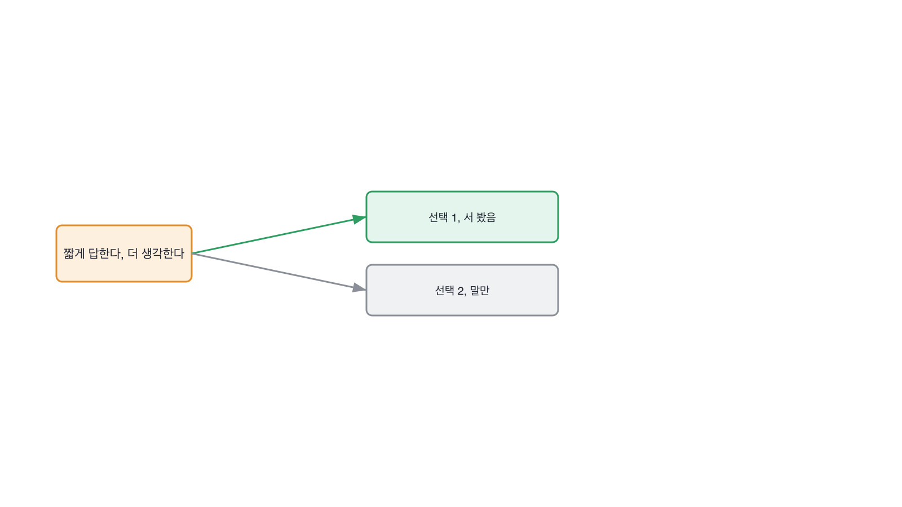
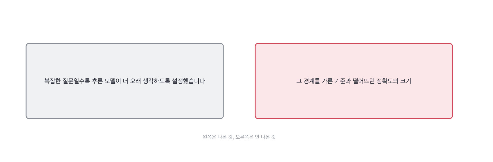

# 17.1 추론을 더 시킬지, 그 경계를 어디서 그었나

*[10.3](../10-g10/q035.md) 에서 크기와 지연과 비용의 삼각형을 봤죠. 추론 모델이 생기면서 그 삼각형에
축이 하나 더 붙었습니다. 얼마나 오래 생각하게 할 것인가요.*

> **이 말부터**
>
> **추론 모델** 답을 내기 전에 중간 과정을 더 길게 쓰는 모델을 말합니다. 길게 쓸수록 맞을 확률은 오르고 그만큼 돈과 시간이 듭니다.
>
> **생각 시간** 모델이 답을 내기 전에 쓰는 중간 과정의 길이를 말해요. 이 칸에서 보는 숫자입니다.

추론 모델을 쓰면 같은 질문도 더 오래 생각하게 만들 수 있습니다. 오래 생각할수록 답은 대체로
좋아지는데, 그만큼 기다리는 시간과 쓰는 돈이 늘어나요. 전부 오래 생각하게 두면 느려지고
비싸지기만 합니다.

그래서 실제로 이걸 운영해 본 사람은 반드시 이 경계를 그어 본 적이 있습니다. 어떤 요청은
짧게 끝내고 어떤 요청만 더 오래 끌고 가는지, 그 기준요. 이 기준을 안 그어 본 사람은
추론 모델을 썼다로 끝납니다. 그어 본 사람은 숫자로 이어 말해요.

> **이렇게 답합니다**
>
> 복잡한 질문일수록 추론 모델이 더 오래 생각하도록 설정했습니다.
> 속도와 정확도의 트레이드오프를 고려해서 적절히 조정했고요.
> 사용자 경험을 해치지 않는 선에서 추론 시간을 최적화했습니다.

방향은 다 맞는 말인데, 복잡하다는 판단을 누가 어떻게 내리는지가 비어 있습니다.

> **표시해 보면**
>
> 복잡한 질문일수록 추론 모델이 더 오래 생각하도록 설정했습니다.
>     ← 복잡하다는 걸 누가 어떻게 판단하는지 없음
> 속도와 정확도의 트레이드오프를 고려해서 적절히 조정했고요.
>     ← 적절히 조정했다는 말에 기준이 없음
> 사용자 경험을 해치지 않는 선에서 추론 시간을 최적화했습니다.
>     ← 해치지 않는 선이 몇 초인지 없음

복잡한 질문일수록 오래 생각하게 했다는 줄에는 복잡함을 가르는 기준이 없습니다.
적절히 조정했다는 말에는 조정의 내용이 없고요. 사용자 경험을 해치지 않는 선이라는
말도 그 선이 몇 초인지 안 나옵니다.

> **이렇게 파고듭니다**
>
> 물음: 복잡한 질문인지는 뭘로 판단하나요?
>
> 답: 음, 모델이 알아서 판단하게 뒀던 것 같아요.

복잡한지는 뭘로 판단하냐는 물음에 모델이 알아서 판단하게 뒀다는 답이 돌아옵니다.
판단 기준을 직접 정한 게 아니라 기본값을 그대로 썼다는 뜻이에요.

> **실물이 나오면**
>
> 처음엔 모든 요청에 똑같이 오래 생각하게 뒀는데, 응답이 8초씩 걸리니까 사용자들이 이탈했어요.
> 로그를 보니까 질문의 80퍼센트 정도는 짧게 답해도 틀리는 비율이 거의 안 변하더라고요.
> 그래서 질문을 먼저 짧은 모델로 한 번 돌려서 자신 있다는 신호가 나오면 그대로 답하고,
> 애매하다는 신호가 나올 때만 추론 모델로 다시 보내게 바꿨습니다.
> 그렇게 하니까 평균 응답 시간이 8초에서 2.4초로 줄었어요.
> 정확도는 1퍼센트 포인트 정도만 떨어졌는데, 그건 감수하기로 팀에서 정했습니다.

이 답은 숫자로 시작해서 숫자로 끝납니다. 모든 요청에 똑같이 오래 생각하게 뒀더니
응답이 8초씩 걸려 사용자가 이탈했다는 문제부터 나와요. 그다음 로그를 보고 질문의
80퍼센트는 짧게 답해도 정확도가 거의 안 떨어진다는 걸 확인했다고 합니다.

그래서 짧은 모델로 먼저 한 번 돌려 자신 있다는 신호면 그대로 답하고, 애매한 신호일 때만
추론 모델로 넘기게 바꿨다고 해요. **응답 시간이 8초에서 2.4초로 줄고, 정확도는 1퍼센트 포인트만
떨어졌다는 교환을 팀이 받아들였다는 줄**까지 있습니다. 경계를 그은 기준과 그 경계를 지키려고
치른 값이 둘 다 나옵니다.

> **여기서 다들 속는다**
>
> 추론 모델을 쓰면 다 좋아 보입니다. 오래 생각할수록 답이 나아진다는 말은 방향은 맞거든요.
> 그런데 방향이 맞다고 모든 요청에 다 적용했다는 뜻은 아닙니다. 다 적용하면 느려지고
> 비싸지기만 해요. 확인은 짧게 끝낸 요청이 있었는지, 그 경계를 어떻게 나눴는지 물으면 됩니다.

그래서 이 칸의 판정도 추론 모델을 썼는지가 아니라 경계를 그었는지를 봅니다.

> **판정**
>
> 짧게 끝낼 요청과 더 끌고 갈 요청을 가른 기준이 나오고, 그 기준을 바꿨을 때 지연이나
> 정확도가 얼마나 움직였는지 숫자로 나오면 통과입니다.
>
> 복잡하다는 말만 반복하고 그 판단을 누가 어떻게 내리는지 못 대면 다음 라운드로 안 보냅니다.
>
> 기록에는 이렇게 적습니다. 모든 요청에 추론 모델을 쓰다 평균 8초가 걸려 이탈이 생겼고,
> 짧은 모델로 먼저 거르는 방식으로 바꿔 응답 시간을 2.4초로 줄이고 정확도는 1퍼센트 포인트
> 낮아지는 것을 감수했다.

> **물을 문장 둘**
>
> 추론 모델을 썼다는 말은 다 비슷하게 들립니다. 그래서 경계를 어디서 그었는지를 바로 묻습니다.
> 경계가 있다는 건 그 경계를 넘나들며 재 본 적이 있다는 뜻이거든요.
>
> **그대로 읽으세요.** *어떤 요청은 짧게 끝내고 어떤 요청만 더 오래 끌고 가셨어요?*
>
> **답을 받으면 이어서.** *그 기준을 바꿔서 지연이나 정확도가 움직인 적 있어요? 얼마나요?*

> **이걸 놓치면**
>
> 이 경계를 못 물으면 [17.3](q058.md) 에서 에이전트가 알아서 오래 끌고 가도록 둔 자리가
> 있었는지도 못 물어보게 됩니다.

