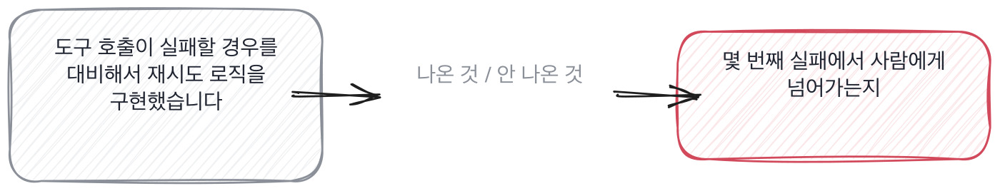

# 17.2 도구를 묶어 쓰다 실패한 자리

*[12.4](../12-g12/q042.md) 에서 AI 가 짠 코드 중 무엇을 안 받았는지 봤죠. 이번엔 AI 가 직접 도구를 불러 움직일 때,
그 호출이 실패하면 무엇을 하는지 봅니다.*

> **이 말부터**
>
> **에이전트** 모델이 도구를 부르고 그 결과로 다음 동작을 스스로 정하는 프로그램을 말합니다. 사람이 매 단계를 안 시켜도 되는 게 이것의 성질이에요.
>
> **도구 호출** 에이전트가 외부 함수나 서비스를 부르는 동작을 말합니다. 호출이 실패하면 에이전트는 그 실패를 받아서 다음 수를 정해야 합니다.

요즘 이력서에 에이전트를 만들었다, 자동화 파이프라인을 구축했다는 말이 흔합니다.
그런데 이 말은 모델 하나를 API 로 부른 것부터 도구 여러 개를 묶어 스스로 다음 수를 정하게 한 것까지
전부 가리켜요. 범위가 너무 넓어서 이 말만으로는 아무것도 못 가려요.

그래서 먼저 물어야 하는 건 에이전트를 만들어 봤냐가 아니라 **도구 호출이 실패했을 때 무엇을 봤냐**입니다.
만들어서 실제로 돌려 본 사람은 반드시 실패를 봤고, 그 실패를 받아 처리한 방식이 있습니다.
돌려 본 적 없는 사람은 성공한 장면만 말해요.

> **이렇게 답합니다**
>
> 도구 호출이 실패할 경우를 대비해서 재시도 로직을 구현했습니다.
> 실패가 반복되면 로그를 남기도록 처리했습니다.
> 전체적인 안정성을 고려해서 예외 처리를 꼼꼼히 했고요.
> 모니터링 체계를 통해 실패율을 추적하고 있습니다.

세 줄 다 맞는 말인데, 실패가 몇 번째에서 무엇으로 이어지는지가 하나도 없습니다.

> **표시해 보면**
>
> 도구 호출이 실패할 경우를 대비해서 재시도 로직을 구현했습니다.
>     ← 몇 번 재시도하는지, 다 실패하면 어떻게 되는지 없음
> 실패가 반복되면 로그를 남기도록 처리했습니다.
>     ← 로그에 무엇이 남는지 없음
> 전체적인 안정성을 고려해서 예외 처리를 꼼꼼히 했고요.
>     ← 안정성을 고려했다는 말에 내용이 없음
> 모니터링 체계를 통해 실패율을 추적하고 있습니다.
>     ← 실패율이 숫자로 안 나옴. 그 숫자를 보고 뭘 했는지도 없음

재시도 로직을 구현했다는 줄에는 몇 번 재시도하는지, 다 실패하면 어떻게 되는지가 없습니다.
예외 처리를 꼼꼼히 했다는 말도 로그에 무엇이 남는지가 없고요.
실패율을 추적한다는 줄은 그 숫자가 얼마고 그 숫자를 보고 뭘 했는지가 안 나옵니다.

> **이렇게 파고듭니다**
>
> 물음: 재시도도 다 실패하면 그다음엔 무슨 일이 일어나요?
>
> 답: 음, 에러를 반환하도록 되어 있을 거예요. 정확히는 잘 기억이 안 나네요.

재시도가 다 실패하면 무슨 일이 나냐는 물음에 기억이 안 난다는 답이 돌아옵니다.
설계는 했는데 실제로 그 자리까지 가 본 적은 없다는 뜻이에요.

> **실물이 나오면**
>
> 검색 도구를 하나 묶어서 썼는데, 그 도구가 타임아웃이 나면 빈 문자열을 돌려주는 경우가 있었어요.
> 초반엔 그걸 처리를 안 해서, 에이전트가 빈 결과를 검색 결과 없음이 아니라 진짜 답처럼 받아들이고
> 그걸로 그럴듯한 답을 지어내는 일이 있었습니다. 로그를 열어 보고서야 알았어요.
> 그래서 타임아웃이랑 빈 결과를 구분해서, 타임아웃이면 같은 질의로 두 번까지만 다시 부르고,
> 두 번 다 실패하면 검색 실패라고 적힌 상태를 다음 단계로 넘기게 고쳤습니다.
> 두 번째 실패부터는 사람이 보는 큐에 쌓이게 했고요. 그 뒤로 지어내는 답이 거의 없어졌습니다.

이 답이 갈리는 지점은 둘째 줄입니다. **타임아웃과 빈 결과를 구분 안 해서 생긴 사고**가 먼저 나와요.
에이전트가 빈 검색 결과를 진짜 답처럼 받아 그럴듯한 답을 지어냈다는 겁니다.
그리고 그걸 로그를 열어 보고서야 알았다는 줄이 있어요. 모니터링이 미리 잡아 준 게 아니라
사람이 뒤늦게 발견했다는 뜻이고, 이게 오히려 정직한 답입니다.

마지막 두 줄이 제일 좋습니다. 재시도 2회까지로 정하고, 그 뒤는 사람이 보는 큐로 넘긴다는 기준요.
숫자가 있고, 그 숫자 뒤에 무엇이 일어나는지도 있습니다.

> **여기서 다들 속는다**
>
> 에이전트를 만들었다는 말은 전부 비슷하게 들립니다. 재시도, 로깅, 모니터링 같은 낱말이 공통으로 나오거든요.
> 이 낱말들은 설계 문서를 한 번만 읽어도 쓸 수 있습니다. **낱말로는 안 갈려요.**
> 갈리는 건 숫자입니다. 몇 번째 실패에서 사람에게 넘기는지, 그 기준을 누가 왜 정했는지.
> 확인은 실패가 반복됐을 때 실제로 무슨 일이 났는지 물으면 됩니다.

그래서 이 칸의 판정은 낱말이 아니라 숫자를 봅니다.

> **판정**
>
> 재시도 횟수나 실패 기준처럼 숫자가 나오고, 그 실패를 사람이 아니라 코드가 먼저 받아서
> 처리한 경험이 나오면 통과입니다. 실패를 알게 된 경로까지 말하면 더 좋고요.
>
> 재시도 로직이 있다는 말만 반복하고 몇 번째 실패부터 무슨 일이 나는지 못 대면 다음 라운드로 안 보냅니다.
>
> 기록에는 이렇게 적습니다. 검색 도구 타임아웃 시 빈 결과를 정답으로 오인해 답을 지어내는 사고가
> 있었고, 재시도 2회 후 실패 상태를 사람 큐로 넘기도록 고쳤다.

> **물을 문장 둘**
>
> 에이전트를 만들었다는 말을 들으면 성공한 장면이 먼저 나옵니다. 그래서 실패한 자리를 바로 묻습니다.
> 실패를 처리한 코드가 있다는 건 그 실패를 실제로 본 적이 있다는 뜻이거든요.
>
> **그대로 읽으세요.** *도구 호출이 실패했을 때 무슨 일이 있었어요?*
>
> **답을 받으면 이어서.** *그 실패를 사람이 먼저 봤어요, 아니면 로그에서 나중에 찾았어요?*

> **이걸 놓치면**
>
> 이 실패를 못 물으면 [17.3](q058.md) 에서 에이전트에게 어디까지 맡겼는지를 물어도
> 근거 없이 맡긴 범위만 돌아옵니다.

