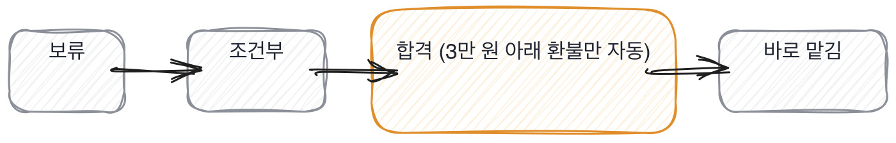
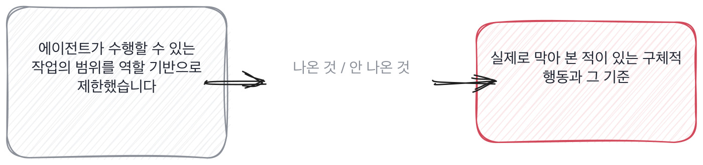

# 17.3 에이전트에게 어디까지 맡겼나

*[15.3](../15-g15/q051.md) 에서 입력을 누가 주는지 봤죠. 이번엔 받은 다음 에이전트가 스스로 무엇을 할 수 있는지,
그 경계를 봅니다.*

> **이 말부터**
>
> **가드레일** 에이전트가 할 수 있는 행동의 경계를 미리 정해 둔 것을 말합니다. 경계를 안 그으면 에이전트는 시킨 적 없는 일까지 합니다.
>
> **되돌릴 수 없는 행동** 실행하면 사람이 다시 손으로 되돌려야 하는 행동을 말해요. 결제, 삭제, 발송 같은 것들입니다.

에이전트에게 도구를 쥐여 주면 할 수 있는 일이 갑자기 늘어납니다. 읽기만 하던 자리에서
쓰기와 지우기와 보내기까지 넘어가요. 이 전환을 해 본 사람은 반드시 어딘가에서 멈칫했던
자리가 있습니다. 이건 사람이 눌러야 하는데, 이건 에이전트가 눌러도 되나 하고요.

안 해 본 사람은 이 물음에 권한을 잘 관리하고 있다는 말로 답합니다. 해 본 사람은
되돌릴 수 없는 행동 하나를 짚어서 **이건 사람이 승인해야 나가게 했다**고 구체적으로 말해요.

> **이렇게 답합니다**
>
> 에이전트가 수행할 수 있는 작업의 범위를 역할 기반으로 제한했습니다.
> 민감한 작업은 별도의 권한 체계를 두어 관리하고 있고요.
> 보안을 고려해서 최소 권한 원칙을 적용했습니다.

세 줄 다 보안 발표 자료에 흔히 나오는 말인데, 실제로 막아 본 행동이 하나도 없습니다.

> **표시해 보면**
>
> 에이전트가 수행할 수 있는 작업의 범위를 역할 기반으로 제한했습니다.
>     ← 역할이 몇 개이고 무엇을 가르는지 없음
> 민감한 작업은 별도의 권한 체계를 두어 관리하고 있고요.
>     ← 민감한 작업이 구체적으로 뭔지 없음
> 보안을 고려해서 최소 권한 원칙을 적용했습니다.
>     ← 실제로 어느 동작을 막았는지 없음

역할 기반으로 제한했다는 줄에는 역할이 몇 개이고 무엇을 가르는지가 없습니다.
민감한 작업이라는 말에는 구체적으로 어떤 동작인지가 없고요.
최소 권한을 적용했다는 줄도 실제로 어느 동작을 막았는지가 안 나옵니다.

> **이렇게 파고듭니다**
>
> 물음: 에이전트가 하면 안 되는 일을 실제로 시도해 본 적 있어요?
>
> 답: 따로 테스트는 안 해봤는데, 설계상 안 되게 돼 있을 거예요.

하면 안 되는 일을 실제로 시도해 본 적 있냐는 물음에 테스트는 안 해봤다는 답이 돌아옵니다.
설계로는 막아 뒀다고 믿지만 실제로 시험해 본 적은 없다는 뜻이에요.

> **실물이 나오면**
>
> 저희 에이전트는 고객 환불 요청을 처리하는데, 처음엔 환불까지 전부 자동으로 나가게 했어요.
> 그런데 한 번은 같은 주문 번호로 두 번 환불 요청이 들어온 걸 다른 주문으로 착각해서
> 중복으로 환불이 나간 적이 있었습니다. 액수는 크지 않았는데 그 뒤로 기준을 바꿨어요.
> 환불 금액이 3만 원 아래고 과거 환불 이력이 없는 주문만 자동으로 나가게 하고,
> 그 밖은 전부 사람이 버튼을 눌러야 나가게 막았습니다. 지금은 자동 처리 비율이 60퍼센트쯤 돼요.
> 나머지 40퍼센트는 에이전트가 초안만 만들고 사람이 확인합니다.

이 답은 사고 하나에서 시작합니다. 같은 주문 번호로 환불 요청이 두 번 들어온 걸
다른 주문으로 착각해 중복 환불이 나간 적이 있었다는 겁니다. 액수는 크지 않았다고
먼저 밝히는 것도 **정직한 답의 표시**예요. 겁나는 이야기를 부풀리지 않습니다.

그 뒤로 기준을 바꿨다는 줄이 핵심입니다. 환불 금액이 3만 원 아래고 과거 환불 이력이
없는 주문만 자동으로 나가게 하고, 나머지는 전부 사람이 승인하게 막았다는 거예요.
자동 처리 비율이 60퍼센트라는 숫자까지 있습니다. 경계를 어디서 그었는지, 그 경계
바깥은 무엇으로 처리하는지가 둘 다 있습니다.

> **여기서 다들 속는다**
>
> 권한을 잘 관리했다는 말은 보안 발표 자료 어디서나 나옵니다. 역할 기반, 최소 권한 같은
> 낱말도 마찬가지고요. **낱말로는 안 갈립니다.** 갈리는 건 되돌릴 수 없는 행동 하나를
> 실제로 막아 본 적이 있는지입니다. 확인은 그 행동이 뭐였는지, 어떻게 막았는지
> 구체적으로 물으면 됩니다.

그래서 이 칸의 판정도 권한 체계라는 말이 아니라 실제로 막아 본 행동을 봅니다.

> **판정**
>
> 되돌릴 수 없는 행동 하나를 짚어서 거기에 사람 승인을 넣은 경험이 나오면 통과입니다.
> 그 경계를 왜 거기서 그었는지 숫자나 사고 경험이 같이 나오면 더 좋고요.
>
> 권한을 잘 관리했다는 말만 반복하고 실제로 막아 본 구체적 행동을 못 대면
> 다음 라운드로 안 보냅니다.
>
> 기록에는 이렇게 적습니다. 중복 환불 사고 이후 3만 원 아래 환불만 자동 처리하고
> 나머지는 사람이 승인하도록 바꿔 자동 처리 비율이 60퍼센트가 되었다.

> **물을 문장 둘**
>
> 권한을 잘 관리했다는 말은 다 비슷하게 들립니다. 그래서 되돌릴 수 없는 행동 하나를
> 짚어서 묻습니다. 그 행동에 사람 승인이 있다는 건 어딘가에서 없이 가 봤다가
> 돌아왔다는 뜻이거든요.
>
> **그대로 읽으세요.** *그 에이전트가 할 수 있는 일 중에 되돌릴 수 없는 게 있었어요? 거긴 어떻게 막으셨어요?*
>
> **답을 받으면 이어서.** *막기 전에 한 번 터진 적 있어요? 그때 뭐가 났어요?*

> **이걸 놓치면**
>
> 이 경계를 못 물으면 [18.1](../18-g18/q059.md) 에서 신뢰 등급을 매길 때 이 사람에게 어디까지 맡길지
> 가늠할 재료가 없습니다.

