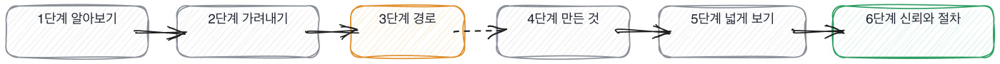
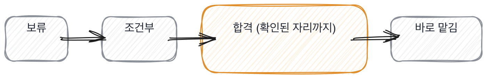

# 18장을 닫으며

## 질문 관리 한 장

질문이 어디에 있고 언제 나가는지를 한 장으로 접으면 이렇게 됩니다.
이 표가 이 책에서 마지막으로 드리는 인쇄물이에요.

- **상태.** 무엇 다음으로 가는 조건 여기서 하는 일
- **새 질문.** 아직 안 써 본 것 한 번 쓰면 시험 중 실물을 붙였는지 본다
- **시험 중.** 세 번까지 써 보는 중 세 번 쓰면 본류 답이 갈리는지 본다
- **본류.** 팀이 쓰는 질문 열두 번 쓰면 물러남 쓸 때마다 한 줄 적는다
- **물러남.** 닳았거나 새어 나간 것 안 돌아온다 왜 나갔는지 적어 둔다

예외가 하나 있습니다. **우리 실물을 가리키는 질문은 새어 나가도 안 물러납니다.**
답이 밖에 돌아도 우리 저장소를 안 열면 못 답하니까요.
그래서 실물에 붙인 질문은 몇 해를 쓰고 교과서 질문은 한 해를 못 갑니다.

이 표의 값은 상태 넷이 아니라 마지막 열에 있습니다. 각 자리에서 무엇을 하느냐요.
본류에서 한 줄씩 안 적으면 열두 번을 셀 수가 없고, 못 세면 물러날 때를 모릅니다.
**적는 일이 은행의 전부입니다.** 나머지는 그 기록에서 저절로 나옵니다.

## AI 엔지니어 채용 테스트 12문항

조엘 스폴스키가 20년 전에 만든 열두 문항짜리 표가 있습니다.
예 아니오로 답하고 점수가 나오는 한 쪽짜리인데, 그게 오래 인용된 이유는
옳아서가 아니라 **한 쪽에 들어가고 지금 당장 답할 수 있어서**입니다 [통설].

그 형식을 물려받아 여기 하나 놓습니다. 회사에 대고 답하지 마세요.
**지금 잡혀 있는 면접 하나**에 대고 답하시면 됩니다.

- **.** 문항 장
- **1.** 무엇을 확인할지 문장으로 먼저 적어 두었는가 6
- **2.** 같은 질문을 모든 후보에게 같은 순서로 묻는가 5
- **3.** 질문 중에 우리 코드나 우리 숫자를 가리키는 것이 하나라도 있는가 17
- **4.** 지원자에게 도구를 써도 된다고 미리 알리는가 17
- **5.** 그 자리에서 실물을 열어 보게 하는가 12
- **6.** 답변에서 버린 쪽과 되돌린 것을 묻는가 7, 8
- **7.** 좋아졌다는 말에 앞 숫자를 받는가 13
- **8.** 판정을 합격 여부가 아니라 등급으로 적는가 18
- **9.** 등급마다 붙는 온보딩의 양이 정해져 있는가 18
- **10.** 디브리프에서 각자 적은 것을 다 낸 뒤에 여는가 18
- **11.** 서류를 도구가 걸렀다면 컷 아래를 사람이 읽는가 17
- **12.** 질문 은행에서 지금까지 뺀 질문이 하나라도 있는가 18

예가 아홉 개 이상이면 그 면접은 다음 주에 다른 사람이 읽고 쓸 수 있습니다.
여섯에서 여덟이면 절반은 그 방에서만 값이 있습니다.
다섯 이하면, 저도 오래 그랬습니다. **여기서 하나만 고치신다면 8번입니다.**

8번을 고르는 이유는 하나입니다. 등급으로 적기 시작하면 나머지가 따라오거든요.
등급을 적으려면 무엇이 확인됐는지 적어야 하고, 그러려면 무엇을 확인할지 먼저 정해야 합니다.
1번과 2번이 8번 뒤에 붙어서 옵니다. 반대 순서로는 잘 안 됩니다.

## 한 관문을 닫으며

이 책이 지나온 여섯 단계를 한 장으로 접으면 이렇게 됩니다.

그리고 마지막 판단은 눈금 하나로 적습니다. 어디까지 맡길지가 그 눈금이에요.

여기까지가 예순한 칸입니다. 마지막으로 한 가지만 짚고 닫겠습니다.

이 책은 의심하는 법을 가르쳤습니다. 그런데 다 의심하는 면접관은 아무도 통과시키지 못하고,
아무도 통과시키지 못하는 면접관은 다음 채용에서 빠집니다.
**그래서 마지막 칸이 통과시키는 법이었습니다.** 등급으로 적으면 통과시킬 수 있거든요.

합격이냐 아니냐로만 두면 확신이 없을 때 못 통과시킵니다. 확신은 45분에 잘 안 생기고요.
그런데 등급이 셋이면 확신이 없는 사람도 붙여서 맡길 수 있습니다.
못 확인한 자리에 여덟 주를 붙이면 되니까요. 그 여덟 주가 확신을 대신합니다.

> **저자의 삽질**
>
> 여럿을 보고 아무도 안 뽑는 해가 있습니다. 기준이 높다고 여기게 되죠. 저도 그렇게 여겼고요.
> 그런데 그사이에도 사람은 나가고 남은 사람이 그만큼 더 일합니다.
> 안 뽑는 것은 판정이 아니라 판정을 미루는 것이고, 미룬 값은 팀이 냅니다.
> 안 보이는 값이라 계산에 안 들어갈 뿐이에요.

이 관문의 것을 쓰실 때는 아래 다섯 줄이면 됩니다.

> **30초 점검**
>
> 판정을 등급으로 적었는가. 붙는 기간까지 적었는가.
> 등급이 자리마다 다를 수 있다는 걸 아는가.
> 디브리프에서 적은 것을 다 낸 뒤에 여는가.
> 질문 은행에 빼는 규칙이 있는가.
> 이번 달에 뺀 질문이 하나라도 있는가.

이 다섯 중 마지막 줄이 제일 잘 안 지켜집니다. 뺄 때가 된 걸 알면서도 안 빼거든요.
아까워서예요. 만드는 데 시간이 든 질문이라 물러나게 하기가 아깝습니다.
그런데 닳은 질문을 남겨 두면 그 자리에서 아무것도 안 갈리고, 45분 중 5분이 그냥 나갑니다.

이 장에서 나온 낱말 몇 개를 짚고 갑니다. 판정하는 자리에서 쓰는 말들이에요.
셋 다 큰 조직에서 온 말이라 작은 팀에는 그대로 안 옮겨 갑니다.
다만 그 말이 가리키는 문제는 팀 크기와 상관없이 똑같이 생깁니다.

> **채용 말 배우기**
>
> **하이어링 커미티** 면접에 안 들어간 사람들이 기록만 보고 판정하는 자리를 말합니다.
>
> **러버 스탬프** 확인 없이 통과 도장만 찍는 것을 말해요. 절차가 하나 늘고 확인은 안 늡니다.
>
> **헤드카운트** 뽑을 수 있는 자리 수를 말합니다. 이게 없으면 면접이 연습이 됩니다.

옛 관행 하나를 재 봅니다. 이 책의 마지막 판정이라 조엘 테스트를 골랐습니다.

> **옛 규칙은 아직 유효한가**
>
> **조엘 테스트.** 판정은 조정해서 유효입니다.
> 근거는 형식입니다. 한 쪽에 들어가고 지금 답할 수 있다는 성질이 여전히 값집니다 [통설].
> 바뀐 것은 문항이에요. 소스 관리와 일일 빌드는 이제 안 물어도 됩니다.
> 그래서 이 책은 형식을 물려받고 문항 열둘을 새로 썼습니다.

판정을 적는 자리에서 제가 실제로 하는 것을 하나 더 적어 둡니다.

> **현장에서는**
>
> 저는 평가표를 면접 끝나고 5분 안에 적습니다. 회의실을 안 나가고 그 자리에서요.
> 나가서 다른 일을 하고 오면 기억이 인상 쪽으로 뭉쳐집니다. 근거가 먼저 사라져요.

판정하는 자리에서 속기 쉬운 데를 둘 짚고 갈게요.

> **여기서 다들 속는다**
>
> 여럿이 같은 판정을 내면 그 판정이 맞는 것처럼 느껴집니다. 넷이 다 통과라고 하면 더 그렇죠.
> 그런데 같이 앉아 있으면 판정이 쏠립니다. 먼저 말한 쪽으로요.
> 그래서 만장일치가 확신의 표시가 아니라 절차가 없다는 표시일 때가 있습니다.
> 확인은 순서를 보면 됩니다. 각자 적은 걸 내기 전에 말이 오갔는지요.

둘째는 질문 은행 쪽입니다. 크면 잘 관리되는 것처럼 보이는 자리요.

> **여기서 다들 속는다**
>
> 질문 은행이 크면 잘 관리되는 것처럼 보입니다. 백 개쯤 쌓여 있으면 든든하죠.
> 그런데 크기는 넣기만 해도 늘어납니다. 관리는 빼는 쪽에서 일어나요.
> 빼 본 적 없는 은행은 창고이고, 창고는 두 해 뒤에 아무도 안 엽니다.
> 확인은 뺀 건수를 물으면 됩니다. 지금까지 몇 개 빼셨냐고요.

마지막으로 이 책이 끝나는 자리에서 하고 싶은 말을 적어 두겠습니다.

> **쉬어 가기**
>
> **쉬어 가기: 안 뽑는 것도 판정이 아니다**
>
> 이 책이 끝나는 자리에서 제일 하고 싶은 말이 이겁니다.
>
> 면접을 배우기 시작하면 대개 의심하는 쪽이 먼저 늡니다. 이 책도 그 순서로 썼고요.
> 빈자리가 보이기 시작하고, 보이면 걸리는 게 많아지고, 그러다 아무도 못 통과시키게 됩니다.
> 그리고 그 상태를 기준이 높다고 부릅니다.
>
> 그렇게 한 해를 보내는 팀이 있습니다. 여럿을 보고 아무도 안 뽑는 해요.
> 그사이에 사람은 나가고 남은 사람이 그만큼 더 일합니다.
> 아낀 것은 잘못 뽑을 위험 하나이고, 낸 것은 한 해입니다.
>
> 여기서 놓치는 게 있습니다. **안 뽑는 것도 판정입니다.** 그리고 값이 있어요.
> 그 값은 안 보일 뿐이지 없는 게 아닙니다. 잘못 뽑은 값은 눈에 보이고
> 못 뽑은 값은 안 보여서, 저는 보이는 쪽만 피하고 있었습니다.
>
> 등급을 셋으로 나눈 이유가 여기 있습니다. 합격이냐 아니냐로만 두면
> 확신이 없을 때 못 통과시킵니다. 그리고 45분에 확신은 잘 안 생겨요.
> 등급이 셋이면 확신이 없는 사람도 붙여서 맡길 수 있습니다. 못 확인한 자리에 여덟 주를 붙이면 되니까요.
>
> 그 여덟 주가 확신을 대신합니다. 이게 이 책이 예순한 칸을 지나 도착한 자리예요.
> 의심하는 법을 배우는 건 절반이고, 나머지 절반은 **통과시키는 법**입니다.

긴 이야기는 여기까지입니다. 이 책의 마지막 다섯 줄이에요.
의심하는 법이 절반이고 통과시키는 법이 나머지 절반입니다.

> **한 관문 요약**
>
> 합격은 문 하나입니다. 등급은 그 뒤에 무엇이 달라지는지를 적은 것이에요.
>
> 등급마다 붙는 기간이 정해져 있어야 등급이 셋인 뜻이 생깁니다.
>
> 같은 기록도 자리가 바뀌면 등급이 바뀝니다. 사람 옆에 하나만 적지 마세요.
>
> 받는 쪽이 증거와 못 보여줄 것을 챙겨 오면 묻는 쪽의 45분이 늘어납니다.
>
> 질문 은행에서 중요한 건 목록이 아니라 빼는 규칙입니다.
>
> 확신이 없어서 못 뽑는 게 아닙니다. 등급이 하나뿐이라 못 뽑는 겁니다.

> **이 판정이 헐거운 지점**
>
> 등급 셋이라는 수는 제가 써 온 것이고 넷이나 둘이 나은 팀도 있을 겁니다.
>
> 붙는 기간 두 주와 여덟 주도 제 자리에서 나온 숫자입니다. 재 본 값이 아닙니다.
>
> 열두 번이면 질문이 닳는다는 것도 제 경험이에요. 팀 크기에 따라 다를 수밖에 없습니다.
