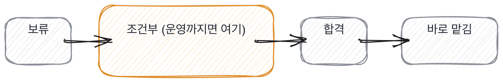

# 18.1 신뢰는 느낌이 아니라 등급이다

*[17.3](../17-g17/q058.md) 까지 에이전트에게 무엇을 맡길지 봤죠. 이번엔 판정을 팀이 쓸 수 있는 모양으로 만듭니다.*

> **이 말부터**
>
> **등급** 이 사람에게 어디까지 맡길지를 셋으로 나눈 것을 말합니다.
>
> **붙는 기간** 등급마다 정해 둔 온보딩의 양이에요. 등급을 쓰는 이유가 이겁니다.

합격이냐 아니냐로만 적으면 다음 주에 아무도 그 판정을 못 씁니다.
합격은 문 하나를 여는 말인데, 들어온 뒤에 무엇이 달라지는지가 안 적혀 있거든요.
**그래서 이 책은 합격을 세 등급으로 적습니다.** 다시 보기, 붙여서 맡김, 바로 맡김.

등급이 셋인 이유는 하나입니다. 등급마다 붙는 온보딩의 양이 다르기 때문이에요.
양이 안 정해져 있으면 등급은 이름만 셋이고 실제로는 하나입니다.
그래서 등급 옆에 반드시 기간이 붙습니다. 두 주냐 두 달이냐요.

```python
GRADES: tuple[Grade, ...] = (
    Grade("다시 보기", 0, "다음 라운드에서 한 번 더 확인한다"),
    Grade("붙여서 맡김", 8, "첫 두 달은 나가는 것마다 같이 본다"),
    Grade("바로 맡김", 2, "첫 두 주만 같이 보고 그 뒤로는 평소대로 본다"),
)
```

두 번째 줄을 보시면 붙여서 맡김이 여덟 주입니다. 바로 맡김보다 여섯 주가 더 붙어요.
이 여섯 주가 판정의 실제 내용입니다. **여섯 주는 사람 하나의 시간이고 값이 있습니다.**
그래서 등급을 대충 매기면 그 값을 팀이 냅니다.

등급을 어떻게 정하느냐가 그다음인데, 저는 평균을 안 냅니다. 빠진 것을 셉니다.
렌즈 여섯 중 이 자리에 필요한 것들을 정해 놓고, 그중 확인이 안 된 게 몇인지 보는 거예요.
평균을 내면 잘한 다섯이 못 한 하나를 덮습니다. 그런데 사고는 그 하나에서 납니다.

돌려 보면 이렇게 나옵니다. 같은 면접 기록을 두 자리에 대고 등급을 매겨 봤습니다

```
같은 면접 기록, 두 자리
  만드는 자리       바로 맡김  붙는 기간 2주  빠진 렌즈 0
      이 자리에 필요한 렌즈 4개가 다 확인됐다
      첫 두 주만 같이 보고 그 뒤로는 평소대로 본다
  운영까지 맡는 자리   붙여서 맡김  붙는 기간 8주  빠진 렌즈 1
      운영 쪽이 확인 안 됐다
      첫 두 달은 나가는 것마다 같이 본다

질문 은행, 둘 다 네 번 쓰고 둘 다 유출됐을 때
  실물에 붙은 질문   본류  쓴 횟수 4
  교과서 질문        물러남  쓴 횟수 4
  은행 상태 {'새 질문': 0, '시험 중': 0, '본류': 1, '물러남': 1}
```

같은 기록인데 등급이 둘로 나옵니다. 만드는 자리면 바로 맡김이고 운영까지면 붙여서 맡김이에요.
빠진 렌즈가 0개냐 1개냐로 갈렸습니다. **사람이 바뀐 게 아니라 자리가 바뀐 겁니다.**
[5.3](../05-g05/q019.md) 에서 렌즈 여섯을 소개했던 그 자리가 여기서 등급으로 회수됩니다.



> **이렇게 적습니다**
>
> 전반적으로 좋은 인상을 받았고 팀에 잘 맞을 것 같습니다.
> 기술적으로도 충분한 역량을 갖추고 있다고 판단됩니다.
> 빠르게 적응해서 좋은 성과를 낼 것으로 기대합니다.

디브리프에서 자주 나오는 세 줄입니다. 셋 다 좋은 말이고 셋 다 다음 주에 못 씁니다.

> **표시해 보면**
>
> 전반적으로 좋은 인상을 받았고 팀에 잘 맞을 것 같습니다.
>     ← 인상. 근거로 못 씀
> 기술적으로도 충분한 역량을 갖추고 있다고 판단됩니다.
>     ← 어느 자리가 충분한지 없음
> 빠르게 적응해서 좋은 성과를 낼 것으로 기대합니다.
>     ← 기대. 맡길 범위가 안 나옴

첫 줄은 인상입니다. 정확할 수도 있는데 근거로 못 써요.
둘째 줄의 충분한 역량은 어느 자리가 충분한지를 안 말합니다.
**셋째 줄은 기대인데, 기대는 판정이 아닙니다.** 세 줄 어디에도 맡길 범위가 없어요.

> **이렇게 파고듭니다**
>
> 물음: 이분한테 운영 당번을 맡기실 수 있어요?
>
> 답: 시간이 좀 지나면 충분히 가능할 것 같습니다.

시간이 지나면 가능하다는 답은 언제인지가 없습니다. 언제가 없으면 아무도 안 챙깁니다.
그리고 이 문장이 위험한 이유가 하나 더 있어요. 지금은 안 된다는 뜻인데 그렇게 안 적힙니다.

> **등급으로 적으면**
>
> 만드는 자리면 바로 맡깁니다. 다섯 중 넷이 확인됐어요.
> 운영까지 맡는 자리면 붙여서 맡깁니다. 배포 뒤에 본 숫자를 못 댔거든요.
> 그래서 두 달은 나가는 것마다 같이 보려고요.
> 두 자리에 등급이 다르게 나오는데, 저는 그게 정상이라고 봅니다.

첫 줄과 둘째 줄이 두 자리에 두 등급입니다. 그리고 갈린 이유가 붙어 있어요.
셋째 줄이 그 등급의 실제 내용이고요. 두 달은 나가는 것마다 같이 본다고 합니다.
**넷째 줄이 이 답의 문장이에요.** 등급이 다르게 나오는 게 정상이라고 말하거든요.

사람 옆에 등급 하나만 적으면 그 숫자가 어디서 왔는지 반년 뒤에 아무도 모릅니다.
[13.1](../13-g13/q043.md) 에서 앞 숫자가 없으면 뒤 숫자도 뜻이 없다고 했던 그 이야기예요.
등급도 같습니다. 무엇에 대한 등급인지가 없으면 그 등급은 아무 말도 안 합니다.

> **현장에서는**
>
> 저는 디브리프 서식에 칸을 셋 뒀습니다. 등급, 빠진 렌즈, 그리고 붙는 기간이요.
> 셋째 칸을 넣고 나서 등급 논쟁이 절반으로 줄었습니다. 값이 눈에 보이니까요.

등급 이야기는 여기까지입니다. 등급 하나와 붙는 기간 하나, 그리고 갈린 이유 한 줄이요.
셋이 적히면 그 판정은 다음 주에 다른 사람이 읽고 씁니다.

> **판정**
>
> 등급을 대고 그 옆에 빠진 렌즈와 붙는 기간을 같이 적으면 통과입니다.
> 자리에 따라 등급이 달라진다고 스스로 말하면 아주 좋은 신호예요.
>
> 좋은 인상이라거나 충분한 역량이라고만 하고, 어디까지 맡기겠냐고 물어도 시간이 지나면
> 가능하다는 식으로 답하면 그 판정은 기록으로 안 씁니다. 다시 앉아서 다시 적습니다.
>
> 기록에는 이렇게 적습니다. 만드는 자리는 바로 맡김에 두 주, 운영까지 맡는 자리는 붙여서
> 맡김에 여덟 주로 적었고, 갈린 이유는 배포 뒤에 본 숫자를 못 댄 것이다.

> **물을 문장 둘**
>
> 통과냐 아니냐만 물으면 인상이 옵니다. 인상은 근거로 못 써요. 그래서 범위를 묻습니다.
> 어디까지 맡길지를 대면 못 맡길 자리가 따라 나오고, 그 자리가 온보딩의 양을 정합니다.
>
> **그대로 읽으세요.** *이분 들어오시면 어디까지 맡기실 거예요?*
>
> **답을 받으면 이어서.** *못 맡기실 자리는요? 거기 붙는 기간을 몇 주로 잡으시겠어요?*

> **이걸 놓치면**
>
> 등급으로 안 적으면 [18.2](q060.md) 에서 디브리프를 해도 목소리 큰 쪽으로 쏠립니다.

