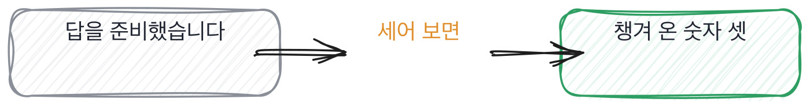

# 18.2 받는 쪽에서 하는 일

*[18.1](q059.md) 에서 등급을 적었죠. 이번엔 그 자리에 앉는 두 사람을 다 봅니다.*

> **이 말부터**
>
> **증거** 저장소, 숫자, 되돌린 기록처럼 말 밖에 남아 있는 것을 말합니다.
>
> **못 보여줄 것** 오늘 확인시켜 드릴 수 없는 자리예요. 미리 정해 오면 그것도 증거입니다.

이 책은 대부분 묻는 쪽에서 썼습니다. 그런데 면접은 혼자 하는 일이 아니에요.
받는 쪽이 준비되면 45분에서 건지는 게 두 배가 됩니다.
**그래서 이 칸 하나를 받는 쪽에 줍니다.** 이 책에서 그런 자리는 여기뿐입니다.

받는 쪽이 흔히 하는 준비는 답을 만드는 것입니다. 예상 질문을 뽑고 답을 다듬죠.
나쁜 준비가 아닙니다. 다만 그렇게 준비한 답은 다들 비슷해집니다.
비슷해지면 안 갈리고, 안 갈리면 그 45분에서 아무도 못 건집니다. 준비한 쪽도 손해예요.

준비를 다르게 하는 방법이 있습니다. 답 대신 **확인받을 것**을 챙겨 오는 거예요.
숫자 서넛, 저장소 하나, 되돌린 이야기 하나. 이 셋이면 45분이 통째로 달라집니다.
이 책이 앞에서 물어 온 것들이 전부 그 셋 안에 있거든요.

그리고 하나 더 있습니다. **못 보여줄 것을 미리 정해 오는 것**이요.
운영을 안 해 봤으면 안 해 봤다고 먼저 말하는 겁니다. 이게 손해처럼 보이는데 아닙니다.
[18.1](q059.md) 에서 봤듯이 못 하는 자리가 있으면 등급이 낮아지는 게 아니라 붙는 기간이 늘어납니다.

> **이렇게 답합니다**
>
> 회사와 직무에 대해 충분히 조사하고 예상 질문을 준비했습니다.
> 제 경험을 잘 전달할 수 있도록 답변을 정리했습니다.
> 기술 스택도 다시 한번 복습하고 왔습니다.

세 줄이 다 성실한 준비입니다. 그리고 세 줄에 증거가 하나도 없습니다.

> **표시해 보면**
>
> 회사와 직무에 대해 충분히 조사하고 예상 질문을 준비했습니다.
>     ← 답을 준비함. 확인받을 것을 준비한 게 아님
> 제 경험을 잘 전달할 수 있도록 답변을 정리했습니다.
>     ← 전달을 다듬음. 증거를 챙긴 게 아님
> 기술 스택도 다시 한번 복습하고 왔습니다.
>     ← 이름을 외움. 어디까지 해 봤는지는 그대로임

첫 줄은 답을 준비한 것이고 둘째 줄은 전달을 다듬은 겁니다.
셋째 줄은 이름을 다시 외운 거고요. 셋 다 말 안쪽에서 일어난 일이에요.
**말 밖에 남는 것이 하나도 안 늘었습니다.** 그게 이 준비의 한계입니다.

> **이렇게 파고듭니다**
>
> 물음: 오늘 못 보여드릴 것 같은 게 뭐예요?
>
> 답: 준비한 내용은 대부분 말씀드릴 수 있을 것 같습니다.

못 보여줄 게 무엇이냐고 물었는데 준비한 걸 다 말할 수 있다고 답합니다.
질문을 비껴간 건데, [1.3](../01-g01/q003.md) 에서 본 그 모양이에요. 어려운 물음 옆의 쉬운 물음에 답한 겁니다.

> **증거를 챙겨 오면**
>
> 숫자 세 개를 적어 왔어요. 0.58에서 0.71, 조각 210개, 그리고 되돌린 게 두 번이요.
> 저장소 주소도 가져왔는데, 회사 코드는 못 드리고 제가 따로 만든 게 있습니다.
> 그리고 못 보여드릴 걸 미리 정리했어요. 운영은 제가 당번을 서 본 적이 없습니다.
> 그건 물어보시면 없다고 말씀드리려고 왔습니다.

첫 줄에 숫자가 셋 나옵니다. 적어 왔다고 말하는 것도 좋아요. 외운 게 아니라 챙긴 겁니다.
둘째 줄에 저장소가 나오는데, 회사 코드는 못 준다는 선까지 같이 그어요.
**셋째 줄과 넷째 줄이 못 보여줄 것입니다.** 운영 당번을 서 본 적이 없다고 먼저 말해요.

이 마지막 두 줄이 저한테는 제일 좋은 신호입니다. 없는 것을 없다고 말하러 온 사람이거든요.
그리고 이 문장 덕분에 저는 운영 쪽에 시간을 안 씁니다. 다른 데 45분을 더 쓸 수 있어요.
**받는 쪽이 준비되면 묻는 쪽의 시간이 늘어납니다.** 그게 두 배가 된다는 말의 뜻입니다.

> **한 번 더**
>
> 디브리프에서 누가 먼저 말하냐고 물으면 한 자리가 더 보입니다.
> 자연스럽게 이야기가 나오는 대로 진행합니다.
> 자연스럽게 진행한다는 말에는 순서가 없습니다. 순서가 없으면 먼저 말한 쪽으로 쏠려요.
> 반대쪽은 적은 걸 먼저 내고 다 낸 뒤에 엽니다. 말은 연차 낮은 순으로 하고요.

적은 걸 먼저 내고 나서 여는 게 전부입니다. 대단한 절차가 아니에요.
그런데 이 한 줄이 없으면 회의실에서 제일 오래 일한 사람의 의견이 나머지를 덮습니다.
덮이는 쪽이 틀렸으면 다행인데, 어느 쪽이 틀렸는지는 그때 아무도 모릅니다.

그리고 어긋난 자리만 이야기한다는 마지막 줄이 좋습니다. 다 같은 등급이면 3분에 끝나요.
디브리프가 길어지는 건 대개 갈려서가 아니라 다들 자기 이야기를 하기 때문입니다.
**어긋난 자리만 보면 짧아지고, 짧아지면 다음에도 합니다.**

> **판정**
>
> 받는 쪽이라면 숫자나 저장소 같은 증거를 챙겨 오고 못 보여줄 것을 먼저 말하면 통과입니다.
> 묻는 쪽이라면 디브리프에서 적은 걸 먼저 내고 여는 순서가 있으면 통과입니다.
>
> 예상 질문을 준비했다거나 자연스럽게 진행한다고만 하고, 못 보여줄 것과 말하는 순서를
> 물어도 안 나오면 그 자리는 아직 절차가 없는 자리로 적습니다.
>
> 기록에는 이렇게 적습니다. 숫자 셋과 따로 만든 저장소를 챙겨 왔고, 운영 당번은 서 본 적이
> 없다고 먼저 밝혔으며, 디브리프는 각자 적은 것을 다 낸 뒤에 열고 연차 낮은 순으로 말한다.

> **물을 문장 둘**
>
> 준비를 물으면 답 준비가 옵니다. 답은 다들 비슷해져요. 그래서 못 보여줄 것을 묻습니다.
> 못 보여줄 것을 대면 그 자리에 시간을 안 써도 되고, 남은 시간이 다른 자리로 갑니다.
>
> **그대로 읽으세요.** *오늘 저한테 못 보여드릴 것 같은 게 뭐예요?*
>
> **답을 받으면 이어서.** *보여주실 수 있는 건요? 숫자로 하나만 들고 오셨다면 뭘까요?*

> **이걸 놓치면**
>
> 증거와 순서를 안 정해 두면 [18.3](q061.md) 에서 질문 은행을 심어도 쓰는 사람이 안 생깁니다.

