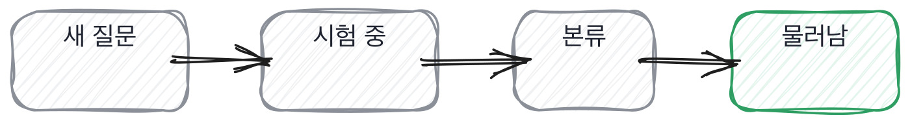

# 18.3 질문 61개를 한 장으로

*[18.2](q060.md) 에서 두 쪽의 준비를 봤죠. 이제 그 판단을 저장소에 심습니다.*

> **이 말부터**
>
> **질문 은행** 팀이 쓰는 질문을 모아 둔 곳을 말합니다. 모으는 게 아니라 관리하는 곳이에요.
>
> **닳은 질문** 여러 번 써서 답이 도는 중인 질문을 말합니다. 좋은 질문일수록 빨리 닳습니다.

마지막 칸입니다. 지금까지 예순 칸에서 물어 온 것을 팀이 쓰는 물건 하나로 만듭니다.
그 물건은 문서가 아니라 저장소에 있는 파일이어야 해요. 문서는 안 열리고 파일은 열립니다.
**그리고 그 파일에서 제일 중요한 것은 질문 목록이 아니라 빼는 규칙입니다.**

질문 은행을 만들면 다들 넣기만 합니다. 좋은 질문이 생기면 추가하고, 그러다 백 개가 되고,
백 개가 되면 아무도 안 엽니다. 은행이 커질수록 안 쓰이는 게 이 자리의 성질이에요.
빼는 규칙이 없으면 반드시 이렇게 됩니다.

질문이 닳는 걸 세는 방법은 간단합니다. 쓴 횟수를 적는 거예요.

```python
    def use(self) -> None:
        """한 번 썼다고 적는다. 적어야 닳은 것을 셀 수 있다."""
        if self.state == RETIRED:
            return
        self.runs += 1
        if self.state == NEW:
            self.state = TRIAL
        elif self.state == TRIAL and self.runs >= TRIAL_RUNS:
            self.state = MAIN
        if self.should_retire():
            self.state = RETIRED

    def mark_leaked(self) -> None:
        """밖에 돌아다니는 것을 봤다. 실물에 붙은 질문은 유출돼도 덜 닳는다."""
        self.leaked = True
        if self.should_retire():
            self.state = RETIRED

    def should_retire(self) -> bool:
        if self.leaked and not self.anchored:
            return True
        return self.runs >= WORN_OUT
```



새 질문이 시험 중으로 가고, 세 번 쓰면 본류가 되고, 열두 번 쓰면 물러납니다.
그리고 유출된 질문은 바로 물러나는데, **한 가지 예외가 있습니다.**
우리 실물을 가리키는 질문은 유출돼도 안 물러납니다.

[17.2](../17-g17/q057.md) 이 여기서 회수됩니다. 실물에 붙인 질문은 답이 밖에 돌아도 값이 안 떨어져요.
우리 저장소를 안 열면 못 답하니까요. 그래서 같은 질문을 몇 해씩 씁니다.
검색되는 질문은 한 번 새면 그날로 끝이고요. 이 차이가 은행의 수명을 정합니다.

> **이렇게 답합니다**
>
> 질문 목록은 위키에 정리해 두고 팀원들이 자유롭게 활용합니다.
> 필요할 때마다 새로운 질문을 추가하고 있습니다.
> 좋은 질문은 계속 사용하면서 노하우를 쌓아가고 있습니다.

세 줄이 다 넣는 이야기입니다. 빼는 이야기가 한 줄도 없어요.

> **표시해 보면**
>
> 질문 목록은 위키에 정리해 두고 팀원들이 자유롭게 활용합니다.
>     ← 모아 둔 이야기. 빼는 이야기가 없음
> 필요할 때마다 새로운 질문을 추가하고 있습니다.
>     ← 넣기만 함. 은행이 커지기만 하면 아무도 안 씀
> 좋은 질문은 계속 사용하면서 노하우를 쌓아가고 있습니다.
>     ← 계속 쓰면 닳는다. 몇 번 썼는지 안 셈

첫 줄은 모아 뒀다는 말이고 둘째 줄은 계속 추가한다는 말입니다.
**셋째 줄이 이 답의 자리예요.** 좋은 질문은 계속 쓴다는 건데, 계속 쓰면 닳거든요.
좋은 질문일수록 빨리 닳습니다. 잘 갈리는 질문이라 지원자들 사이에서 먼저 돕니다.

> **이렇게 파고듭니다**
>
> 물음: 거기서 빠진 질문이 지금까지 몇 개예요?
>
> 답: 특별히 삭제한 경우는 없었던 것 같습니다.

삭제한 경우가 없다는 답이 이 칸의 판정입니다. 은행이 아니라 창고예요.
창고는 넣기만 하는 곳이고, 넣기만 하는 곳은 두 해 뒤에 아무도 안 엽니다.

> **관리하는 팀이면**
>
> 쓸 때마다 한 줄씩 적습니다. 누가 언제 썼고 답이 어땠는지요.
> 열두 번 넘어가면 물러나게 했어요. 지금까지 넷이 나갔습니다.
> 밖에 도는 걸 본 것도 하나 있었는데, 그건 우리 코드를 가리키는 질문이라 그냥 뒀어요.
> 답을 미리 알아도 우리 저장소를 안 열면 못 답하니까요.

첫 줄에 세는 방법이 나옵니다. 쓸 때마다 한 줄씩 적는다고 하죠.
둘째 줄에 빼는 규칙과 실제 건수가 나오고요. 열두 번, 그리고 지금까지 넷.
**셋째 줄과 넷째 줄이 예외예요.** 우리 코드를 가리키는 질문은 유출돼도 그냥 뒀다고 합니다.

돌려 보면 이렇게 나옵니다. 등급을 매기고 질문 은행이 어떻게 도는지 봤습니다

```
같은 면접 기록, 두 자리
  만드는 자리       바로 맡김  붙는 기간 2주  빠진 렌즈 0
      이 자리에 필요한 렌즈 4개가 다 확인됐다
      첫 두 주만 같이 보고 그 뒤로는 평소대로 본다
  운영까지 맡는 자리   붙여서 맡김  붙는 기간 8주  빠진 렌즈 1
      운영 쪽이 확인 안 됐다
      첫 두 달은 나가는 것마다 같이 본다

질문 은행, 둘 다 네 번 쓰고 둘 다 유출됐을 때
  실물에 붙은 질문   본류  쓴 횟수 4
  교과서 질문        물러남  쓴 횟수 4
  은행 상태 {'새 질문': 0, '시험 중': 0, '본류': 1, '물러남': 1}
```

출력 아랫부분을 보시면 둘 다 네 번 쓰고 둘 다 유출됐는데 한쪽만 물러났습니다.
교과서 질문은 나갔고 실물에 붙은 질문은 본류에 남았어요.
이게 이 책이 예순 칸에서 해 온 이야기가 마지막에 도착하는 자리입니다.

> **현장에서는**
>
> 저희 은행에는 질문마다 줄이 하나씩 붙어 있습니다. 언제 누가 썼고 답이 어땠는지요.
> 그 줄이 쌓이면 어느 질문이 잘 갈리는지가 보입니다. 세 번이면 대충 보입니다.

질문 은행 이야기는 여기까지입니다. 뺀 건수 하나면 그 은행이 도는지 안 도는지 알 수 있어요.
이 책의 마지막 질문이기도 합니다.

> **판정**
>
> 빼는 규칙이 있고 지금까지 몇 개를 뺐는지 대면 통과입니다.
> 유출된 질문 중에 안 뺀 것이 있고 그 이유를 대면 아주 좋은 신호예요.
>
> 위키에 모아 두고 자유롭게 쓴다고만 하고, 뺀 질문이 몇 개냐고 물어도 없다고 하면
> 그 은행은 아직 창고입니다. 쓴 횟수를 안 세는 경우도 같이 적어 둡니다.
>
> 기록에는 이렇게 적습니다. 쓸 때마다 한 줄씩 적고 열두 번이 넘으면 물러나게 해서
> 지금까지 넷을 뺐으며, 유출된 것 하나는 우리 코드를 가리켜서 그냥 뒀다고 말했다.

> **물을 문장 둘**
>
> 질문 은행을 물으면 목록 이야기가 옵니다. 목록은 늘리기 쉬워요. 그래서 뺀 것을 묻습니다.
> 뺀 건수를 대면 쓴 횟수를 센다는 뜻이고, 세는 팀만 은행을 계속 씁니다.
>
> **그대로 읽으세요.** *거기서 빠진 질문이 지금까지 몇 개예요?*
>
> **답을 받으면 이어서.** *안 뺀 것 중에 밖에 돈 게 있나요? 그건 왜 두셨죠?*

> **이걸 놓치면**
>
> 빼는 규칙이 없으면 이 책의 예순한 칸도 두 해 뒤에는 안 열리는 목록이 됩니다.

